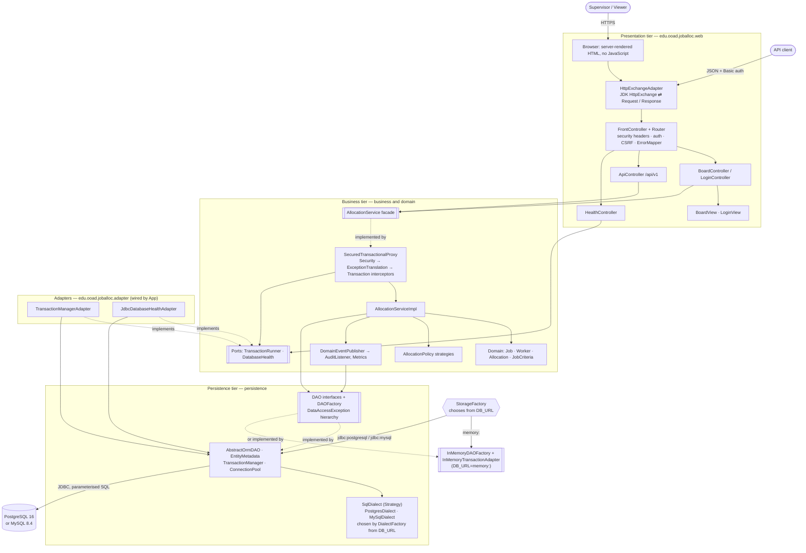
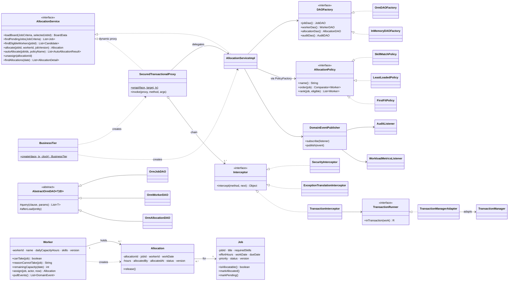
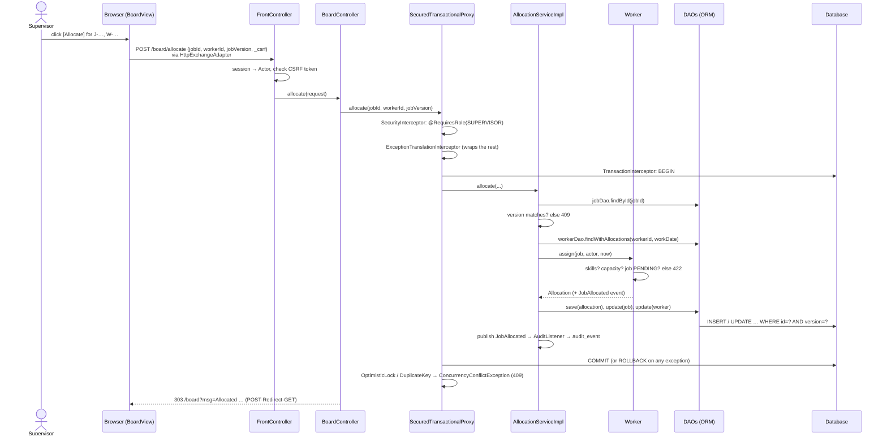
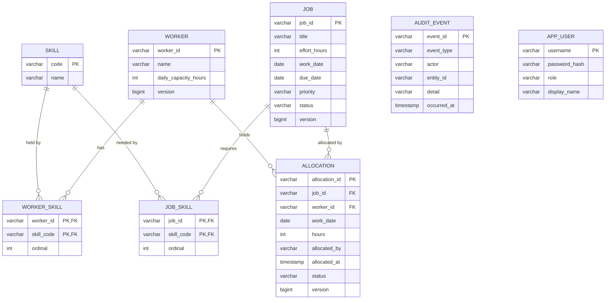

# Architecture — Workload Job Allocation

This document is kept in sync with the code. `ArchitectureTest` fails the build if a layer depends on a layer it should not, so the dependency arrows below are enforced, not just drawn.

## 1. Tiers and layers

Layers organise the code; tiers are where it runs. In this demo all three layers run in one JVM (the application server) and the database (PostgreSQL by default, or MySQL) is the separate data node; with `DB_URL=memory:` there is no data node.

**Switching storage.** `DB_URL` is the only switch; nothing else changes and nothing is recompiled:

| `DB_URL` | `Storage` | DAOs | Transactions | Health |
|---|---|---|---|---|
| `jdbc:postgresql://…` | `RelationalStorage` + `PostgresDialect` | `OrmDAOFactory` | `TransactionManagerAdapter` | `JdbcDatabaseHealthAdapter` |
| `jdbc:mysql://…` | `RelationalStorage` + `MySqlDialect` | `OrmDAOFactory` | `TransactionManagerAdapter` | `JdbcDatabaseHealthAdapter` |
| `memory:` | `InMemoryStorage` | `InMemoryDAOFactory` | `InMemoryTransactionAdapter` (lock + snapshot) | always UP |

Any other value fails at start-up with the list of supported forms (decisions D17, D19 and D21).

The business tier owns two small **ports** (`TransactionRunner`, `DatabaseHealth`). The persistence tier does not know them; two **adapters** outside both layers implement them using `TransactionManager`, and `App` (the composition root) wires them in. This is the Dependency Inversion Principle applied without breaking the "downward only" rule.

Allowed dependencies (enforced by `ArchitectureTest`):

| Layer | May depend on | Must not depend on |
|---|---|---|
| `web` | `business` (facade, ports, exceptions), `domain` | any `persistence` package, `adapter`, JDBC; `com.sun.net.httpserver` outside `HttpExchangeAdapter`, `FrontController`, `WebServer` |
| `business` | `domain`, `persistence.dao` (DAO interfaces and exceptions) | `web`, `adapter`, `persistence.orm`, `persistence.ormdao`, `persistence.memory`, JDBC |
| `domain` | `persistence.mapping` annotations only (like `jakarta.persistence`) | everything else |
| `persistence` | `domain` | `business`, `web`, `adapter` |
| `adapter` | `business.port`, `persistence.orm` | `web` |

## 2. Class diagram (core)

## 3. Sequence: Allocate (UI → database)

## 4. Data model

The same logical schema runs on PostgreSQL and MySQL; the scripts are in `src/main/resources/db/migration/{postgresql,mysql}/` with the same version numbers. The full PlantUML schema with every constraint is `../diagrams/src/26-db-schema.puml`.

Database-level rules back up the domain rules:
- check constraints on hours, priority, status and role;
- foreign keys from every skill value to `skill` (before V3, the `text[]` arrays could not have them);
- at most one ACTIVE allocation per job: a partial unique index on PostgreSQL; a generated column `active_job_id` with a unique index on MySQL;
- append-only `audit_event`: a PL/pgSQL trigger on PostgreSQL; two `SIGNAL` triggers on MySQL.

Timestamps are stored as UTC instants (PostgreSQL `timestamptz`; MySQL `datetime(6)` with the session time zone forced to UTC by `MySqlDialect`).

## 5. Traceability: UI → API → service → domain → DAO

| UI element | Board route | REST endpoint | Service operation | Domain behaviour | DAO calls |
|---|---|---|---|---|---|
| Whole board page | `GET /board` | — | `loadBoard` (one transaction) | as the rows below | as the rows below |
| Pending Jobs grid / Refresh | `GET /board` | `GET /api/v1/jobs` | `findPendingJobs` | — | `JobDAO.findPending` |
| Select job | `GET /board?jobId=` | `GET /api/v1/jobs/{id}/eligible-workers` | `findEligibleWorkers` | `Worker.canTake`, `reasonCannotTake`, `AllocationPolicy.rank` | `WorkerDAO.findAllWithAllocations` |
| Allocate | `POST /board/allocate` | `POST /api/v1/allocations` | `allocate` | `Worker.assign`, `Job.markAllocated` | `AllocationDAO.save`, `JobDAO.update`, `WorkerDAO.update`, `AuditDAO.append` |
| Auto-Allocate | `POST /board/auto-allocate` | `POST /api/v1/allocations/auto` | `autoAllocate` | `AllocationPolicy.rank` → `Worker.assign` | as Allocate |
| Unassign | `POST /board/unassign` | `DELETE /api/v1/allocations/{id}` | `unassign` | `Allocation.release`, `Job.markPending` | `AllocationDAO.update`, `JobDAO.update`, `AuditDAO.append` |
| Allocations list | `GET /board` | `GET /api/v1/allocations` | `findAllocations` | — | `AllocationDAO.findActiveByDate`, `JobDAO.findByIds`, `WorkerDAO.findByIds` |
| (API only) one job, with ETag | — | `GET /api/v1/jobs/{id}` | `getJob` | — | `JobDAO.findById` |
| (API only) one allocation | — | `GET /api/v1/allocations/{id}` | `getAllocation` | — | `AllocationDAO.findById`, `JobDAO.findById`, `WorkerDAO.findById` |
| (API only) the contract | — | `GET /api/v1/openapi.yaml` | — | — | — |

The REST contract is `src/main/resources/api/openapi.yaml` (OpenAPI 3.1); see [`api-integration.md`](api-integration.md).

API errors are RFC 9457 Problem Details (`application/problem+json`), and every response carries `X-Request-Id`. HTTP status mapping (one table, `ErrorMapper`): 304 not modified (ETag) · 412 stale If-Match · 400 bad input · 401 not signed in · 403 role or CSRF · 404 unknown ID · 409 stale version or concurrent change · 413 body over 64 KB · 422 business rule · 500 unexpected (with reference ID).

## 6. Design decisions

| # | Decision | Why | Trade-off |
|---|---|---|---|
| D1 | No frameworks (JDK HTTP server, own ORM) | Students see the mechanics; the build works offline with 7 small jars | Not production-grade; production code would use Spring Boot + Hibernate |
| D2 | Server-rendered HTML, no JavaScript | Simplest 3-tier UI; allows CSP `script-src 'none'` | Full page reloads |
| D3 | Explicit DAO interfaces over an ORM | Matches the slides' DAO + Template Method; enables in-memory unit tests | More code than Spring Data repositories |
| D4 | Optimistic locking on Job and Worker | Two supervisors can't double-book a job or overbook a worker | User sees 409 and must refresh |
| D5 | Synchronous event listeners in the same transaction | Audit commits or rolls back with the allocation | Slow listeners slow the request; e-mail would need an outbox |
| D6 | Domain classes carry mapping annotations | Same trade-off as JPA: less mapping code | Domain depends on `persistence.mapping` (allowed explicitly) |
| D7 | Demo jobs regenerated per day | Board is never empty in class | Not for production (`APP_DEMO_DATA=false`) |
| D8 | Ports owned by the business tier + adapters outside the layers | Business never imports the ORM; persistence never imports business | Two extra small classes and a package |
| D9 | Proxy as an interceptor chain | Each cross-cutting concern is one class; new ones need no edit to the proxy | One more indirection when debugging |
| D10 | Coarse-grained `loadBoard` on the facade | One transaction per page: a consistent snapshot | The facade has one UI-shaped operation |
| D11 | Exception translation in the DAO tier | Vendor SQLSTATE codes stay in persistence | A small exception hierarchy to maintain |

| D12 | Configuration schema in code (`Setting`) + Rego for per-environment rules | Shape validated at start-up; what is allowed is reviewed as policy | Two places to look (by design: mechanism vs policy) |
| D13 | Policy as code with Conftest on facts exported from the code | Governance rules are tested and cannot be bypassed by a forgotten checklist | Needs the Conftest binary (`make tools`) |
| D14 | Contract-first OpenAPI, checked both ways by a test | API drift fails the build | The YAML is hand-written (no generator) |
| D15 | Idempotency store in memory | Simple and correct for one instance | A shared store is needed when scaling out |
| D16 | Bootstrap 5.3 **CSS only**, vendored and served from `/static` | Responsive, accessible look with no build step and no JavaScript, so CSP `script-src 'none'` and `style-src 'self'` still hold; no CDN, so no third-party request and the file is hash-pinned | Components that need Bootstrap JS (dropdowns, modals, collapsing navbar) are not used; the view code carries Bootstrap class names |
| D17 | Database product chosen by `DB_URL`: `SqlDialect` Strategy + `DialectFactory` | PostgreSQL and MySQL run the same code and the same tests; a new product is one class + its scripts | The schema is written once per product; only what the tests prove is "supported" |
| D18 | Skills in collection tables (`@CollectionTable`), not arrays | Portable to every relational database; foreign keys on each value; loaded with one query per collection (no N+1) | Two extra tables; updates replace the whole set |
| D19 | Storage family as an Abstract Factory (`Storage`: DAOs + transactions + health), chosen by `DB_URL` | In-memory and relational storage are interchangeable; DAOs can never be mixed with the wrong transactions | One more indirection in `App` |
| D20 | Migrations validated by checksum; the database may not be ahead of the code | Edited scripts and accidental downgrades fail fast instead of corrupting data | A legitimate edit needs a new version (by design) |
| D21 | In-memory transactions = one lock + snapshot (Memento) | Same all-or-nothing behaviour as a database, simple to reason about | Serialised writes and a full copy per transaction: fine for demo-sized data only |
| D22 | Single sign-on with OpenID Connect written in plain Java (authorization code + PKCE, state, nonce; `IdTokenVerifier` checks signature, issuer, audience, expiry and nonce) | Students see every check a library would hide; one code path serves Google, Microsoft, Apple and any OIDC provider (`OidcProvider` data + `OidcProviders` factory) | Security-critical code the team must maintain; a production system would use a certified library (Nimbus, Spring Security). See `docs/sso.md` |
| D23 | Accounts linked by **verified e-mail** only; SSO can create at most a VIEWER (`Provisioning`) | Prevents account takeover through an unverified address and privilege gain through a new provider | An administrator must add e-mails and grant SUPERVISOR by hand |
| D24 | Login CSRF: double-submit token (`JA_LOGIN` cookie + hidden `_csrf`) on the sign-in form | There is no session yet to hold a token; stops an attacker signing a victim into the attacker's account | One more cookie scoped to `/login` |
| D25 | Security gates as make targets (Gitleaks, Semgrep, OSV SCA, Conftest governance, ZAP, scripted WSTG pen test) and audit as code (`audit/controls.json` → hashed evidence pack) | The same commands run on a laptop, in CI and for an auditor; each control is traceable to ASVS, ISO 27001 and WSTG | Tools are pinned and downloaded once (`make tools`, `make tools-dast`); a scripted pen test does not replace a manual one |
| D26 | AI-assisted engineering is governed like any other risk: risk register, human review checklist, disclosure in every pull request, enforced by governance rule G8 and audit control GOV-04 | AI output is treated as untrusted input until reviewed and gated; the policy cannot be dropped silently | A gate checks that the practice exists, not that reviews were done well; that stays a human responsibility. See `docs/ai-assisted-engineering.md` |

See [`refactoring-review.md`](refactoring-review.md) for the before/after of each change and the anti-patterns it removed.

## 7. Relationship to the course diagrams

`../diagrams/src/` holds the analysis and design diagrams (PlantUML) used in the slides; this document holds the as-built view (Mermaid). The Strategy diagram (`07-strategy.puml`) shows the three policies implemented here: SKILL_MATCH, LEAST_LOADED and FIRST_FIT.
