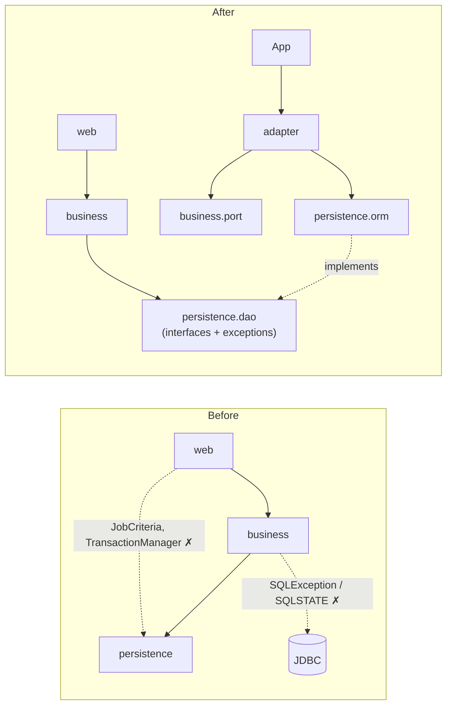

# Refactoring Review — DRY, Clean Architecture and Design Patterns

**Scope:** `app/` (Java sources 97 → 125 files, plus `config/`, `policy/`, `api/`) · **Date:** 2026-11-06 · **Status:** complete, every gate green

Part 1 (sections 1-8) is the design refactoring: DRY, clean architecture and GoF patterns. Part 2 (section 9) adds configuration as code, policy as code, coding conventions, an OpenAPI contract and integration patterns.

## 1. Summary

The reference implementation already followed a 3-tier design with a facade, a proxy, DAOs and strategies. The review found ten anti-patterns: repeated code (DRY violations), dependencies that pointed the wrong way (layer leaks), a chatty facade, an N+1 query and two latent defects in the Singleton. Twelve refactorings removed all of them. Behaviour is unchanged: every existing test still passes, and the browser tests confirm the screens work as before.

| Measure | Before | After |
|---|---|---|
| Layering violations found by the strengthened `ArchitectureTest` | 8 (6 layer leaks, 1 JDBC leak, 1 server-API leak) | **0** |
| Copies of the JDBC "connection → prepare → execute → translate" block | 4 | **1** |
| Places that map exceptions to HTTP status | 2 (must be kept in step) | **1** (`ErrorMapper`) |
| Places that parse `date` / `priority` / `skill` | 2 controllers | **1** (`RequestBinding`) |
| Places that wire the business tier | 2 (`App`, unit test) | **1** (`BusinessTier.create`) |
| Facade calls / transactions to render the board | 6 calls / 4 transactions | **1 call / 1 transaction** |
| Queries for the allocations list (N allocations) | 2 + N (and all workers loaded) | **3** |
| Responsibilities inside the proxy class | 3 (security, transaction, SQL error codes) | **0** (delegated to 3 interceptors) |
| Unit / integration / end-to-end tests | 30 / 17 / 3 | **69 / 27 / 4** (after Part 5; integration and e2e run on PostgreSQL, MySQL and in-memory storage) |
| Automated quality gates | compile + tests | **+ Checkstyle (0 violations), 27 Rego policy checks with 18 policy tests, Spectral API lint, OpenAPI contract test** |
| Executable lines (excluding comments and blanks) | 3,289 | 3,523 (+7%) |

> **Note:** DRY did not make the code shorter. The extra lines are small single-purpose classes (interceptors, adapters, ports, the error table) that each give one concept one home. "Fewer lines" is not the goal; "one place to change" is.

## 2. Anti-patterns found

| # | Anti-pattern | Where (before) | Why it is harmful | Fixed by |
|---|---|---|---|---|
| A1 | **Copy-paste programming** (DRY violation) | `AbstractOrmDAO` (JDBC block ×4); priority parsing in `ApiController` and `BoardController`; "eligible worker" filter in two service methods; sort and tie-break in all three policies; business wiring in `App` and `AllocationServiceTest`; HTML skeleton in `ErrorPage`; cookie attributes ×2 | A fix applied to one copy is missed in the others, and the copies drift apart. The test wiring could differ from production without anyone noticing | R1, R4, R6, R8, R9, R12 |
| A2 | **Leaky abstraction** | `SecuredTransactionalProxy` read `SQLException.getSQLState() == "23505"` | The business tier knew a PostgreSQL error code. Changing the database would mean editing business code, and in-memory DAOs could never raise that condition | R1 |
| A3 | **Layer skipping** (architecture violation) | `HealthController` and `WebServer` imported `TransactionManager`; both controllers imported `persistence.dao.JobCriteria` | The presentation tier reached into persistence, bypassing the facade. The architecture test needed a hard-coded exemption for `HealthController` | R2, R3 |
| A4 | **Chatty interface** (fine-grained facade) | `BoardController.board()` made 6 facade calls, 4 of them separate transactions | 4 round trips per page, and the page was not a consistent snapshot: a job allocated between two calls could appear both as pending and as allocated | R5 |
| A5 | **N+1 query** | `findAllocations` loaded every worker, then each allocation's job one by one | Query count grows with data. 50 allocations meant 52 queries | R5 |
| A6 | **Type switch on exceptions / shotgun surgery** | `if (e instanceof …) else if …` in `FrontController`, plus a matching multi-catch list in `BoardController` | Adding one business exception required edits in two classes. Forgetting one turned a 409 into a 500 | R6 |
| A7 | **Test-only code paths in production** | `Request` had a second constructor and `if (exchange == null)` branches for tests | Production code carried test logic, and the JDK server type was spread through the web tier | R7 |
| A8 | **"God" invocation handler** (Single Responsibility violation) | `SecuredTransactionalProxy` did authorisation, transactions and exception translation | Every new cross-cutting concern meant editing the same class (breaks Open/Closed) | R2 |
| A9 | **Singleton pitfalls** | `ConnectionPool.initialize()` silently returned the old pool when called with different settings; a broken connection was replaced without being closed or tracked; a check-then-increment race could push the counter past `maxSize` | Wrong-database bugs with no error, connection leaks, and wrong pool statistics. A Singleton's global state hides these until production | R10 |
| A10 | **Magic strings / duplicated knowledge** | `OrmJobDAO` hard-coded `'CRITICAL','HIGH','MEDIUM','LOW'`; `"23505"` inline | Reordering or adding a `Priority` would silently mis-sort the grid | R1, R11 |
| A11 | **Internal model exposed as public API** | `POST /api/v1/allocations/auto` serialised the business record `AutoAllocationResult` directly | Renaming a field in the business tier silently changed the REST contract that clients depend on | R7 |
| A12 | **Anonymous adapter hidden in the composition root** | `App` adapted `TransactionManager` with an anonymous inner class; the test repeated it | The adaptation existed twice, had no name, and could not be tested on its own | R3 |

| A13 | **Dangling resource link** | `POST /api/v1/allocations` returned `Location: /api/v1/allocations/{id}`, but no GET route existed | Clients following the link got 404; the API broke its own REST contract | Part 2: `GET /api/v1/allocations/{id}` |
| A14 | **Home-made error format** | `{status, message}` JSON | Every client needed custom parsing; no type URI, no correlation | Part 2: RFC 9457 Problem Details |
| A15 | **Late, unvalidated configuration** | `Integer.parseInt(env...)` with no range checks; any profile, URL or boolean accepted | A typo surfaced as a bare `NumberFormatException`, or not at all until the first request | Part 2: `Setting` schema, fail-fast `ConfigurationException` |
| A16 | **Secrets as literals in a committed file** | `POSTGRES_PASSWORD: joballoc` in `compose.yaml` | The pattern spreads to real environments; secrets end up in Git history | Part 2: variables from `.env`, enforced by `policy/compose.rego` |
| A17 | **Unsafe retries** (non-idempotent POST) | A client retrying a timed-out allocation | Retry after a lost response could be double-processed or confusingly fail with 409 | Part 2: `Idempotency-Key` (Idempotent Receiver) |
| A18 | **Type-switch complexity** | `EntityMetadata.readColumn` (cyclomatic complexity 21), `FrontController.dispatch` (14) | Hard to test every branch; each new type edits the same method | Part 2: lookup table of readers; authentication extracted to `authenticate()` |

| A19 | **Primitive obsession / magic numbers** | HTTP status codes as bare `int`s in a dozen places and two parallel `switch` statements in `ProblemDTO`; unexplained limits (`24`, `64`, `200`, `16`) | A typo such as `490` compiles; the meaning of each number lives in people's heads | Part 2: `HttpStatus` enum (code, problem type, title), named constants such as `HOURS_PER_DAY`, `MAX_USERNAME_LENGTH` |
| A20 | **Names that hide the role** | `JdbcDatabaseHealth` in `adapter`, `Delegate` (abstract), `pathExists()` returning boolean | Readers cannot tell what a class is, or whether a method asks or acts | Part 2: `JdbcDatabaseHealthAdapter`, `AbstractDelegate`, `hasPath()`; enforced by `NamingConventionTest` |

### Anti-patterns checked and not found

| Anti-pattern | Result |
|---|---|
| Anemic domain model | Not present: `Worker.canTake()`, `Worker.assign()`, `Job.markAllocated()` hold the rules (GRASP Information Expert) |
| SQL injection by string building | Not present: every value is a bound parameter; the only concatenated SQL is metadata (table and column names) |
| Service Locator | `ConnectionPool.getInstance()` exists but nothing calls it. All dependencies are passed in by constructor injection from `App` |
| Circular package dependencies | None (checked by `ArchitectureTest`) |

## 3. Refactorings: before → after → why

### R1. Exception translation at the persistence boundary · DRY template for JDBC

Patterns: **Template Method** (refined), **Exception Translation**, **Metadata Mapping**

**Before:** the business tier decoded a vendor error code, and every DAO operation repeated the JDBC block.

```java
// business/SecuredTransactionalProxy.java
if (t instanceof PersistenceException e && e.getCause() instanceof SQLException sql
        && "23505".equals(sql.getSQLState())) { ... }

// persistence/ormdao/AbstractOrmDAO.java — repeated in save, update, query, execute
tx.withConnection(con -> {
    try (PreparedStatement ps = con.prepareStatement(sql)) { ... }
    catch (SQLException e) { throw translate(..., e); }
});
```

**After:** persistence translates its own errors into the DAO contract's hierarchy, and the JDBC block exists once.

```java
// persistence/dao: DataAccessException ← OptimisticLockException, DuplicateKeyException
private static DataAccessException translate(String sql, SQLException e) {
    return UNIQUE_VIOLATION.equals(e.getSQLState())
            ? new DuplicateKeyException(message, e) : new DataAccessException(message, e);
}

private <R> R withStatement(String sql, StatementWork<R> work) { /* the only JDBC block */ }
```

INSERT and UPDATE SQL is generated once per entity type in `EntityMetadata`, not on every call.

**Why:** the business tier now depends only on the DAO *contract* (interfaces plus exceptions), not on JDBC. `InMemoryDAOFactory` raises the same exception types, so unit tests exercise the same error paths as production.

### R2. Proxy as an interceptor chain

Patterns: **Proxy**, **Chain of Responsibility**

**Before:** one `invoke()` method checked the role, opened the transaction and translated SQL errors.

**After:** the proxy runs an ordered list of single-purpose interceptors.

```java
SecuredTransactionalProxy.wrap(AllocationService.class, real, List.of(
        new SecurityInterceptor(),               // 1. role check, before any database work
        new ExceptionTranslationInterceptor(),   // 2. DAO exceptions → business exceptions
        new TransactionInterceptor(tx)));        // 3. begin / commit / roll back
```

**Why:** each concern is one class (Single Responsibility). A new concern, such as timing or auditing reads, is a new interceptor, and the proxy itself does not change (Open/Closed). The order is now explicit and tested. A forbidden call is rejected before a transaction opens (`proxyChecksTheRoleBeforeOpeningATransaction`). Translation sits outside the transaction, so errors raised at commit time are translated too. This is how Spring's `@PreAuthorize` and `@Transactional` advice chain works.

### R3. Ports and Adapters for transactions and health

Patterns: **Adapter** (new), **Dependency Inversion**

**Before:**

```java
// App.java — anonymous adapter (repeated in AllocationServiceTest)
new SecuredTransactionalProxy.TransactionRunner() {
    public <R> R inTransaction(Supplier<R> work) { return tx.inTransaction(work); }
};
// web/controller/HealthController.java — JDBC in the presentation tier
tx.withConnection(con -> con.createStatement().execute("select 1"));
```

**After:** the business tier owns the interfaces it needs (ports). Named adapters outside the layers implement them.

```java
// business/port/TransactionRunner.java, business/port/DatabaseHealth.java  (targets)
// adapter/TransactionManagerAdapter.java implements TransactionRunner  → TransactionManager (adaptee)
// adapter/JdbcDatabaseHealthAdapter.java       implements DatabaseHealth     → TransactionManager (adaptee)
WebServer web = new WebServer(..., business, new JdbcDatabaseHealthAdapter(tx), ...);
```

**Why:** "business must not import persistence.orm" and "persistence must not import business" are both now true. The adapters live in `edu.ooad.joballoc.adapter`, the only package that knows both sides, and `App` wires them in. `HealthController` no longer needs an exemption in the architecture test.

### R4. Factory for the business tier

Pattern: **Factory** (new: `BusinessTier.create`)

**Before:** `App` and `AllocationServiceTest` each built the publisher, the two listeners, the implementation and the proxy (8 lines each).

**After:**

```java
BusinessTier business = BusinessTier.create(daos, new TransactionManagerAdapter(tx), clock);
// test:
service = BusinessTier.create(daos, countingRunner, TestData.CLOCK).service();
```

**Why:** the unit test now exercises exactly the production wiring. A new listener is added in one place.

### R5. Coarse-grained facade operation · N+1 removed

Patterns: **Facade** (refined), **Identity Map** (complemented by bulk loading)

**Before:**

```java
// BoardController.board(): 6 facade calls, 4 transactions
service.findPendingJobs(...); service.getJob(id); service.findEligibleWorkers(id);
service.listSkills(); service.findAllocations(date); service.policyNames();

// AllocationServiceImpl.findAllocations(): 1 + 1 + N queries
active.stream().map(a -> new AllocationDetail(a, loadJob(a.getJobId()), ...));
```

**After:**

```java
BoardData data = service.loadBoard(criteria, jobId);    // 1 call, 1 transaction

jobs.findByIds(jobIds); workers.findByIds(workerIds);   // 3 queries in total
```

`GenericDAO.findByIds` has a default implementation for in-memory DAOs. The ORM overrides it with one `where id = any(?)` query.

**Why:** a facade should offer operations shaped by the client's use case, not mirror the DAOs. One transaction gives a consistent snapshot of the board. Bulk loading keeps the query count constant as data grows.

### R6. One exception → HTTP status table

Pattern: **Table-driven mapping** (replaces a type switch)

**Before:** an `instanceof` chain in `FrontController`, plus a multi-catch list in `BoardController.act()` that had to match it.

**After:**

```java
STATUS.put(NotFoundException.class, 404);
STATUS.put(ConcurrencyConflictException.class, 409);
STATUS.put(AllocationRuleException.class, 422); ...
ErrorMapper.statusOf(e);            // used by FrontController
ErrorMapper.isUserCorrectable(e);   // used by BoardController (400/404/409/422 → flash message)
```

**Why:** adding an exception is one line in one table. Subclasses map through their nearest registered superclass, so `NumberFormatException` correctly becomes 400.

### R7. Adapter for the JDK HTTP server · explicit API DTO

Patterns: **Adapter** (new: `HttpExchangeAdapter`), **DTO**

**Before:** `Request` wrapped `HttpExchange` and had a second, test-only constructor with `if (exchange == null)` branches. `FrontController.write()` wrote directly to the exchange.

**After:**

```java
Request request = HttpExchangeAdapter.toRequest(exchange);           // adaptee → target
HttpExchangeAdapter.write(exchange, withSecurityHeaders(response));  // target → adaptee
```

`Request` is now a plain value (headers are case-insensitive), with no server type and no test branches. The architecture test allows `com.sun.net.httpserver` only in `HttpExchangeAdapter`, `FrontController` and `WebServer`. The auto-allocate endpoint returns `AutoAllocationResultDTO`, not the business record.

**Why:** controllers and the router can be tested without a server. Moving to Jetty or a servlet container would mean writing one new adapter.

### R8. Shared request binding

Pattern: **DRY helper** (`RequestBinding`, `Request.enumParam`, `Request.optionalParam`)

**Before:** two copies of `Priority.valueOf(p.toUpperCase())` with try/catch, two `blankToNull` helpers, and `LocalDate.now(clock)` repeated three times.

**After:**

```java
JobCriteria criteria = RequestBinding.jobCriteria(req, clock);
```

**Why:** the API and the board can no longer parse the same filter differently.

### R9. Strategy with a Template Method

Patterns: **Strategy** (refined), **Template Method** (default method), shared stateless instances

**Before:** each policy repeated `eligible.stream().sorted(X.thenComparing(Worker::getWorkerId)).toList()`, and two of them repeated the capacity comparator.

**After:**

```java
public interface AllocationPolicy {
    Comparator<Worker> order(Job job);                    // the varying step
    default List<Worker> rank(Job job, List<Worker> eligible) {  // the fixed algorithm
        return eligible.stream().sorted(order(job).thenComparing(Worker::getWorkerId)).toList();
    }
}
```

`PolicyFactory` now holds one shared instance per policy (they are stateless) and rejects duplicate names, which used to replace a policy silently.

**Why:** a new policy is one comparator. Deterministic tie-breaking can no longer be forgotten.

### R10. Singleton hardened

Pattern: **Singleton** (kept, defects fixed)

| Defect (before) | After |
|---|---|
| `initialize(otherUrl, …)` silently returned the existing pool | Fails fast with `IllegalStateException` unless the settings match |
| Invalid connection replaced without `close()`; replacement not tracked for shutdown | Old one closed and removed; new one tracked |
| `created.get() < max && created.incrementAndGet() <= max` could overshoot | Compare-and-set loop (`reserveSlot()`); the slot is released if opening fails |

**Why:** a Singleton's static state outlives the code that created it, so misuse shows up far from its cause. Discussion point for class: frameworks prefer a DI-managed singleton scope over a static accessor.

### R11. Magic strings removed

**Before:** `array['CRITICAL','HIGH','MEDIUM','LOW']` hard-coded in SQL, and `"23505"` inline.

**After:** the SQL rank is generated from `Priority.values()`, and `UNIQUE_VIOLATION` is a named constant inside persistence.

### R12. Small DRY fixes

`Response.json(status, object)` serialises for the caller (removing `Json.write` at every call site). `ErrorPage` uses the shared `Html.page` layout. Session-cookie attributes are defined once.

## 4. Clean architecture: dependency rule before and after



`ArchitectureTest` now enforces the "After" picture with five layer rules and two extra checks (no JDBC in business; the JDK server API only in its adapter). Run against the original code, it reports the 8 violations counted in section 1. Run against the refactored code, it passes.

## 5. Design patterns used in the code (complete catalogue)

Status key: **New** added in this refactoring · **Refined** existing, restructured · **Kept** unchanged

### GoF creational

| Pattern | Where | Benefit | Status |
|---|---|---|---|
| Abstract Factory | `DAOFactory` → `OrmDAOFactory`, `InMemoryDAOFactory` | Swap the whole persistence family (relational ↔ in-memory) without touching services; fast unit tests | Kept |
| Factory | `PolicyFactory.forName()` | The UI picks a rule by name; adding a rule needs no service change | Refined (shared instances, duplicate check) |
| Factory | `BusinessTier.create()` | One definition of the business-tier wiring for production and tests | **New** |
| Static factory methods | `Response.html/json/redirect`, `AutoAllocationResult.skipped`, `*DTO.from` | Named construction; invalid combinations are hard to build | Kept / New |
| Singleton | `ConnectionPool` | One bounded pool per process | Refined (fail-fast, leak and race fixed) |

### GoF structural

| Pattern | Where | Benefit | Status |
|---|---|---|---|
| Facade | `AllocationService` (+ `loadBoard`) | One entry point per use case; the UI never sees DAOs, policies or transactions | Refined (coarse-grained) |
| Proxy (protection + transaction) | `SecuredTransactionalProxy` via `java.lang.reflect.Proxy` | Security and transactions without touching business code; callers cannot tell the difference | Refined (interceptor chain) |
| Adapter | `HttpExchangeAdapter` (JDK server ⇄ `Request`/`Response`) | Web code is framework-free and testable without a server | **New** |
| Adapter | `TransactionManagerAdapter`, `JdbcDatabaseHealthAdapter` (persistence ⇄ business ports) | Dependency inversion without breaking "downward only" layering | **New** |

| Decorator | `IdempotentHandler` wraps any route `Handler` | Adds idempotency to a POST without changing the controller | **New** (Part 2) |

### GoF behavioural

| Pattern | Where | Benefit | Status |
|---|---|---|---|
| Strategy | `AllocationPolicy` + 3 policies | Allocation rules change without editing the service (Open/Closed) | Refined |
| Template Method | `AbstractOrmDAO.query()` + `afterLoad` hook; `AllocationPolicy.rank()` default method | The fixed algorithm is written once; subclasses supply only the varying step | Refined / **New** |
| Chain of Responsibility | `Interceptor` chain inside the proxy | Cross-cutting concerns are added, removed or reordered independently | **New** |
| Observer | `DomainEventPublisher`, `AuditListener`, `WorkloadMetricsListener` | New side effects are new listeners; the use case does not change | Kept |

### Enterprise (PoEAA) and architectural

| Pattern | Where | Benefit | Status |
|---|---|---|---|
| Layered architecture / 3-tier | `web` → `business` → `persistence` | Separation of concerns; enforced by `ArchitectureTest` | Refined (stricter rules) |
| Ports and Adapters (Dependency Inversion) | `business.port.*` + `adapter.*` | The business tier owns its abstractions | **New** |
| Composition Root | `App.start()` | The only place that knows concrete classes | Kept |
| Front Controller | `FrontController` + `Router` | One place for headers, authentication, CSRF and error mapping | Refined |
| Data Access Object | `GenericDAO`, `JobDAO`…, `findByIds` | Business sees interfaces, never SQL | Refined |
| Exception Translation | `AbstractOrmDAO.translate` → `DataAccessException` hierarchy | Vendor errors stay in persistence | **New** |
| Query Object | `JobCriteria` (moved to `domain`) | One filter type shared by UI, service and DAO without a layer leak | Refined |
| Data Transfer Object | `web.dto.*` (+ `AutoAllocationResultDTO`) | A stable API contract, decoupled from the model | Refined |
| Metadata Mapping | `EntityMetadata` (+ cached SQL) | Mapping declared once by annotations; SQL generated once | Refined |
| Identity Map | `TransactionManager.TxContext` | One object per row per transaction | Kept |
| Unit of Work (transaction scope) | `TransactionManager.inTransaction` | All changes of a use case commit or roll back together | Kept |
| Optimistic Offline Lock | `@Version` + `OptimisticLockException` → HTTP 409 | No lost updates between two supervisors | Kept |
| Service Layer | `AllocationServiceImpl` | Use-case orchestration separated from domain rules | Kept |
| Domain Model | `Job`, `Worker`, `Allocation` | Rules live with the data | Kept |
| Post-Redirect-Get | `BoardController.act` | A refresh never repeats an allocation | Kept |
| Entity–Control–Boundary | Views (boundary), controllers and service (control), domain (entity) | Analysis classes trace to code | Kept |

### Integration, API and delivery patterns (Part 2)

| Pattern | Where | Benefit | Status |
|---|---|---|---|
| Contract-first API (OpenAPI 3.1) | `src/main/resources/api/openapi.yaml`, `OpenApiContractTest`, `make api-lint` | One versioned contract for clients and code; drift fails the build | **New** |
| Problem Details (RFC 9457) | `ProblemDTO`, `Response.problem` | Standard machine-readable errors | **New** |
| Correlation Identifier (EIP) | `X-Request-Id`, access log, `requestId` | Trace one request across client and server logs | **New** |
| Idempotent Receiver (EIP) | `IdempotentHandler` + `IdempotencyStore` | Safe client retries | **New** |
| Optimistic concurrency over HTTP | `ETag` / `If-Match` / `If-None-Match` | Lost-update protection end to end; cheap revalidation (304) | **New** |
| Configuration as Code | `config.Setting`, `config/*.env.example`, `ConfigurationTest` | Validated, documented, versioned settings; template cannot drift | **New** |
| Policy as Code | `policy/*.rego` + tests, `PolicyInputExport`, `make policy` | Security and governance rules are reviewed, tested and enforced like code | **New** |
| Fitness functions | `ArchitectureTest`, Checkstyle, Spectral, Conftest | Architectural and design intent checked on every build | Refined |

### GRASP and principles

| Principle | Where |
|---|---|
| Information Expert | `Worker.canTake()`, `Worker.reasonCannotTake()` |
| Creator | `Worker.assign()` creates the `Allocation` |
| Controller | `BoardController`, `ApiController` |
| Low Coupling / Protected Variations | Ports, DAO interfaces, `HttpExchangeAdapter` |
| Pure Fabrication | `ErrorMapper`, `RequestBinding`, `TransactionManagerAdapter` |
| SRP / OCP / DIP (SOLID) | Interceptors (SRP, OCP), policies (OCP), ports (DIP) |

## 6. Patterns considered and not applied

Applying a pattern without a force to resolve is itself an anti-pattern ("pattern-first design").

| Pattern | Why not |
|---|---|
| Builder for `BoardView.Model` | The record now has 6 fields, all required; a builder would add code without removing a problem |
| Decorator instead of Proxy | Would need one hand-written class per interface method. The dynamic proxy plus interceptors covers every facade method generically |
| Repository (DDD) | The DAOs already return whole aggregates (`findWithAllocations`); renaming adds nothing for this course |
| Command (for undo) | No undo requirement yet. This is the planned class exercise ("Swap allocation", slide 32) |
| DI container | Constructor injection from one composition root is enough for 20 wired objects, and students can see every `new` |

## 7. Verification

| Check | Result |
|---|---|
| `make test`: domain, business, web, Singleton, architecture, naming, configuration, OpenAPI contract | 69 passed (30 before) |
| `make test-int`: PostgreSQL 16, ORM, locking, `findByIds`, HTTP API, OWASP checks, integration patterns | 23 passed (17 before) |
| `make lint`: Checkstyle 14.4.0 | 0 violations |
| `make policy`: Conftest 0.71.1 | 18 policy unit tests and 27 checks pass. 1 advisory warning: pin the image by digest |
| `make api-lint`: Spectral 6.17.0 | No warnings or errors |
| `make e2e`: Playwright in Chrome (allocate, unassign, viewer read-only, bad password) | 3 passed |
| Compiler | `javac -Xlint:all -Werror`: no warnings |
| Architecture test against the *original* code | Fails with the 8 violations listed above (proves the test catches them) |

New tests: `proxyChecksTheRoleBeforeOpeningATransaction`, `loadBoardIsOneTransactionWithEverythingThePageShows`, `allocationsListLoadsJobsAndWorkersInBulk`, `factorySharesStatelessPoliciesAndRejectsDuplicateNames`, `HttpLayerTest` (3), `ConnectionPoolTest` (2), `onlyTheAdapterTouchesTheJdkHttpServer`, `businessTierHasNoJdbc`, `findByIdsLoadsSeveralRowsInOneQuery`.

## 8. Recommended next steps (not done in this change)

| # | Recommendation | Why |
|---|---|---|
| N1 | Per-job (object-level) authorisation as a fourth interceptor | Closes OWASP API1 (BOLA). The chain from R2 makes it a one-class change |
| N2 | `SecurityContext` on `ScopedValue` (Java 21+ preview, final in 25) instead of `ThreadLocal` | A better fit for virtual threads; no clean-up needed |
| N3 | Replace the hand-written pool with HikariCP in a production variant | Proven pool, metrics, leak detection |
| N4 | Transactional outbox before any e-mail listener | Keeps events reliable when listeners become asynchronous |
| N5 | `InMemoryDAOFactory` raising `DuplicateKeyException` for a second active allocation | Lets the unit tests cover the 409 race path that today only the integration test covers |
| N6 | Mutation testing (PIT) in CI | Shows whether the 41 unit tests would catch real faults, not just run the code |

## 9. Part 2: configuration, policy, conventions and API

| # | Change | Before → after | Why |
|---|---|---|---|
| P1 | **Configuration as code** | Raw `getOrDefault` + `parseInt` → `Setting` enum (schema), `AppConfig.from` validates and reports every problem at once; `config/app.env.example` generated and golden-tested; `config/prod.env.example` without secrets | Fail fast, self-documenting, no drift between code, template and runbook |
| P2 | **Policy as code** | Rules lived in people's heads and the runbook → `policy/compose.rego`, `policy/config.rego`, `policy/access.rego`, each with `*_test.rego` | Security and governance rules are reviewed, versioned, tested and enforced in CI (`make policy`) |
| P3 | **Access policy from real facts** | — → `PolicyInputExport` reflects `@RequiresRole` / `@Transactional` and reads the live route table | A viewer-callable write operation or an unlisted public route fails the build |
| P4 | **Coding conventions** | Implicit style → `.editorconfig`, `config/checkstyle/checkstyle.xml` (0 violations), `docs/coding-conventions.md`, `.pre-commit-config.yaml` | Consistent code; reviews focus on design, not formatting |
| P5 | **Complexity reduced** | `readColumn` if-chain (CC 21) → table of readers; `dispatch` (CC 14) → `authenticate()` extracted; metadata scan extracted | Each method has one reason to change and is under the limit of 12 |
| P6 | **Pinned tools** | — → `tools.sha256` for Checkstyle and Conftest; `api/package-lock.json` for Spectral | Same supply-chain discipline as `lib.sha256` |
| P7 | **Contract-first API** | No contract → OpenAPI 3.1 served at `/api/v1/openapi.yaml`, Spectral house rules, `OpenApiContractTest` (both directions) | Clients and code agree by construction |
| P9 | **Formatting and naming enforced** | Basic Checkstyle → full formatting (indentation, wrapping, whitespace, import groups, member order) and every identifier form; `NamingConventionTest` checks role suffixes, exception names and question-style boolean methods | Consistent, readable code; names that say what a class is |
| P8 | **Integration patterns** | Custom errors, no correlation, unsafe retries, version only in body → Problem Details, `X-Request-Id`, `Idempotency-Key`, `ETag`/`If-Match`, `GET /allocations/{id}` | Industry-standard behaviour that gateways, SDKs and operators expect |

Details: [`coding-conventions.md`](coding-conventions.md) and [`api-integration.md`](api-integration.md).

## 10. Part 3: responsive, professional UI

| # | Change | Before → after | Why |
|---|---|---|---|
| U1 | **Bootstrap 5.3.8 (CSS only)** | Hand-written CSS → vendored `static/bootstrap.min.css` behind a small brand layer `static/app.css` | Tested grid, forms and tables; consistent spacing and type; no JavaScript, so the strict CSP is unchanged |
| U2 | **Responsive layout** | Fixed two-column page → Bootstrap grid: side by side on wide screens, stacked on tablets and phones; low-value columns hidden below 768 px; tables scroll inside their card | Usable on a phone; the page never scrolls sideways |
| U3 | **Visual hierarchy** | Plain tables and buttons → cards with count badges, colour-coded priority badges, a load meter per worker, primary/success/danger button roles | The next action and the most urgent job stand out |
| U4 | **Accessibility kept** | `.sr` helper → Bootstrap `visually-hidden`; every input has a `<label for>`; alerts use `role="status"`/`role="alert"`; selected row has `aria-current`; visible focus ring | WCAG 2.1 AA basics; the e2e tests still find controls by role and label |
| U5 | **Supply-chain and CSP guards** | — → `StaticAssetsTest`: Bootstrap SHA-256 pinned; no view may emit `style=` or `<script>` | A swapped or edited CSS file, or markup the CSP would block, fails `make test` |
| U6 | **Phone test** | Desktop only → e2e at 390 × 844: no page overflow, Skills column hidden, Select button fully on screen | Responsiveness is checked, not assumed |

Licence: Bootstrap is MIT; recorded in `THIRD_PARTY_NOTICES.md` with its copyright header kept in the file. Screenshots: `docs/images/ui-*.png` (also used in the user guide).

## 11. Part 4: more than one database product (PostgreSQL and MySQL)

Question asked: *is the persistence built with design patterns that handle different databases?* Answer before this part: **the layering was ready, the SQL was not.** DAO interfaces, the Abstract Factory and exception translation already kept the business tier database-neutral, but PostgreSQL-only SQL sat inside the persistence tier.

### Anti-patterns found

| # | Anti-pattern | Where | Why it matters |
|---|---|---|---|
| A21 | **Vendor lock-in through SQL** | `text[]` arrays, `= any(?)`, `array_position`, `cross join lateral`, `on conflict`, `to_char`, `limit` | Every other product rejects the SQL; switching is a rewrite |
| A22 | **Primitive obsession in the schema** | Skills as arrays inside `worker` and `job` | No foreign key per value: a misspelt skill code is accepted |
| A23 | **Vendor code as a magic constant** | `"23505"` in `AbstractOrmDAO` | Only PostgreSQL's duplicate key was recognised |
| A24 | **Leaky validation** | `DB_URL` accepted only `jdbc:postgresql://` (hard-coded in `Setting`) | Configuration and code disagree as soon as a second product exists |
| A25 | **Demo data as vendor SQL** | `demo-jobs.sql` with date functions and upsert | Data that is not code was written in one product's dialect; it also skipped today when yesterday's "tomorrow" job existed |

### Refactorings

| # | Change | Before → after | Pattern / principle |
|---|---|---|---|
| M1 | **`SqlDialect` interface** with `PostgresDialect`, `MySqlDialect` | Vendor specifics scattered → one small interface: migration folder, connection properties, first-rows clause, validation query, "is duplicate key" | **Strategy** (GoF); Open/Closed |
| M2 | **`DialectFactory.forUrl(DB_URL)`** | — → the URL prefix chooses the dialect; unknown products fail fast with the supported list; `Setting.DB_URL` reuses `isSupported` | **Factory**; single source of truth (DRY) |
| M3 | **Collection tables** `worker_skill`, `job_skill` + `@CollectionTable` | Arrays → one row per value with `ordinal`; loaded with one query per collection | **Metadata Mapping** extended (like JPA `@ElementCollection`); avoids **N+1 queries** |
| M4 | **Portable SQL** | `= any(?)` → `IN (?, …)` in chunks of 500; `array_position` → `CASE` generated from the enum; skill filter → correlated `EXISTS` | Standard SQL first, dialect only where unavoidable |
| M5 | **Migrations per product, versions aligned** | One folder → `db/migration/{postgresql,mysql}/V1..V3`; PostgreSQL **V3 migrates live data** from arrays to tables (V1/V2 untouched) | **Evolutionary database design**; never edit an applied migration |
| M6 | **Statement splitter in `Migrator`** | Whole script in one `execute` (needs multi-statement mode on MySQL) → one statement at a time; `allowMultiQueries=false` | Least privilege: multi-statement mode widens SQL-injection impact |
| M7 | **Demo data as CSV through the DAO** | Vendor SQL → `demo-jobs.csv` + `JobDAO.save`; inserts only missing ids | Data separated from code; fixes the "empty today" bug |
| M8 | **MySQL-specific rules kept in the schema** | Partial unique index → generated column `active_job_id` + unique index; PL/pgSQL trigger → two `SIGNAL` triggers | Same business rule enforced by both databases |
| M9 | **UTC instants on MySQL** | — → session time zone forced to UTC by `MySqlDialect` | `allocated_at` means the same moment everywhere |
| M10 | **Policy P7** | — → production `DB_URL` must verify TLS (`sslmode=verify-full` / `sslMode=VERIFY_IDENTITY`) | Policy as code; each driver spells it differently |

### Verification

| Check | Result |
|---|---|
| `make check` (Checkstyle, 63 unit tests incl. `DialectTest`, 22 Rego tests, Spectral) | Pass |
| `make test-int` on PostgreSQL 16 (fresh database: V1 → V3) | 23 passed |
| Existing PostgreSQL database with V1/V2 and live data → V3 | 12 array values → 12 `job_skill` rows, 10 worker skills moved, columns dropped, 4/4 browser tests pass |
| `make test-int` on MySQL 8.0 (fresh database: V1 → V3) | 23 passed with MySQL Connector/J 26.10.0 |
| `make e2e` with the app on MySQL | 4 passed with MySQL Connector/J 26.10.0 |
| Instants stored in UTC on MySQL | Events from the Connector/J run are stored at the UTC time. An earlier trial with a different driver that ignored `connectionTimeZone` stored Singapore wall-clock time (8 hours out), which shows why `MySqlDialect` sets it |
| Architecture and naming tests | Domain and business may not import `persistence.dialect`; dialect classes end in `Dialect` |

### Not done (and why)

- **Oracle / SQL Server**: same steps (one dialect class, one script folder, the driver), but the Oracle image is about 2 GB and its driver is not OSI-licensed; little extra teaching value.
- **Moving data between products**: out of scope; export/import is a data-migration project of its own.
- **Testcontainers**: would start each database from the test itself; it needs Maven/Gradle dependency management, which this framework-free build avoids.

Diagrams: `26-db-schema.puml` (schema, both products), `27-sql-dialect.puml` (Strategy + Factory), and the updated 03, 05, 08, 12, 17, 18, 18b, 21, 22.

## 12. Part 5: in-memory storage, migration safety and rollout

Requests: *add an in-memory database handled by the same design patterns*; *handle database migration, test and rollout too*.

### Anti-patterns found

| # | Anti-pattern | Where | Why it matters |
|---|---|---|---|
| A26 | **Test double that only works in tests** | `InMemoryDAOFactory` had no transactions and plain `HashMap`s | Fine for one-thread unit tests; under a web server a failed allocation would leave half its changes and concurrent requests could corrupt the maps |
| A27 | **Mismatched product families possible** | `App` wired DAOs, transactions and health separately | Nothing stopped MySQL DAOs being combined with a transaction runner for another store; atomicity would silently break |
| A28 | **Silent migration drift** | `schema_version` held only version numbers | An edited script, or old code on a newer schema, went unnoticed until data broke |
| A29 | **Singleton assumes one database forever** | `ConnectionPool` | Copying PostgreSQL to MySQL needs two pools at once |
| A30 | **Rollout by memory** | Runbook "upgrade" had six lines and no rollback matrix | Operators improvise under pressure |

### Refactorings

| # | Change | Before → after | Pattern / principle |
|---|---|---|---|
| S1 | **`Storage` family** (`daos()`, `transactions()`, `health()`) with `RelationalStorage` and `InMemoryStorage`; `StorageFactory.create(config)` | Hand wiring in `App` → one call; families cannot be mixed | **Abstract Factory** one level above `DAOFactory`; **Factory Method** |
| S2 | **In-memory transactions** | None → one reentrant lock + a snapshot of every store, restored if the work throws | **Memento**; same contract as a database transaction (serialisable isolation) |
| S3 | **Thread-safe in-memory DAOs** | Plain maps → each DAO wrapped in a `java.lang.reflect.Proxy` that holds the lock per call | **Proxy** (protection/synchronisation proxy) |
| S4 | **`InMemoryTransactionAdapter`** | — → twin of `TransactionManagerAdapter`: the business tier cannot tell the stores apart | **Adapter** to the business tier's port |
| S5 | **Reference data for memory as CSV** | — → `db/memory/*.csv`; a unit test proves the rows equal the SQL V2 seed | Data as configuration; drift caught by a test |
| S6 | **Migration checksums + validation** | Version only → SHA-256 per script, baseline for older databases, `CHANGED` / `UNKNOWN` stop start-up | Evolutionary database design (as Flyway's `validate`) |
| S7 | **Rollout tools** | — → `make db-status`, `db-migrate`, `db-copy`, `smoke`; `DatabaseTool` | Operations as code |
| S8 | **`StorageTransfer`** | — → copies every table between ANY two storages through the DAO interfaces, in one target transaction, idempotent | The payoff of Abstract Factory: one algorithm for every pair |
| S9 | **`ConnectionPool.standalone`** | Singleton only → a documented second pool for tools; the app still has exactly one | Singleton trade-off made explicit |
| S10 | **Policy P8** | — → `APP_PROFILE=prod` with `DB_URL=memory:` is denied (P7 no longer double-reports it) | Policy as code |

### Verification

| Check | Result |
|---|---|
| `make check` | 69 unit tests (incl. `InMemoryStorageTest`), 24 Rego tests, Checkstyle 0, Spectral clean |
| `make test-int` on PostgreSQL 16 / MySQL 8.0 / memory | 27 / 27 / 15 passed (memory skips the SQL-only `PersistenceIT`) |
| Browser tests on PostgreSQL / MySQL / memory | 4 / 4 / 4 passed |
| Rollback of a failed in-memory transaction | Update, insert and audit row all undone (unit test) |
| 8 threads × 50 concurrent transactions in memory | 400 jobs, no lost writes (unit test) |
| Checksum baseline on an existing database, then an edited V2 | Baseline recorded; edited script reported `CHANGED`, `make db-status` exit 1; restored → "Up to date." |
| `make db-copy` PostgreSQL → MySQL (fresh) and → memory (dry run) | Identical counts in all tables (8 jobs, 12 job skills, 10 worker skills, 7 allocations, 14 audit events); timestamps identical to the microsecond |

Diagrams: `28-storage-family.puml` (Abstract Factory, Memento, Proxy) and `29-rollout-activity.puml` (release, migration and rollback as a UML activity diagram).

## 13. Part 6: single sign-on, security gates and AI-assisted engineering

Requests: sign-in through Google, Microsoft and Apple; governance as code, audit as code, SAST, DAST and pen test; a secret-leak gate; AI-assisted risk and governance practice.

### Anti-patterns found

| Anti-pattern | Where | Risk |
|---|---|---|
| Login form without CSRF protection | `LoginController` | Login CSRF: a victim is silently signed in to an attacker's account (found by the scripted pen test, finding F3) |
| Security checks only in reviewers' heads | Whole repository | Secrets, injection-prone SQL and unpinned jars could be committed without anyone noticing |
| "One user = one password" assumption in `AuthService` | Business security | No way to add another identity source without editing the password path |

### Refactorings

| Change | Pattern / principle | Why |
|---|---|---|
| `OidcProvider` (data) + `OidcProviders` (factory from settings) | Factory, Data over code | Google, Microsoft, Apple and a generic provider differ only in data (issuer, endpoints, response mode, client authentication) |
| `AppleClientSecret` | Strategy for client authentication | Apple signs a JWT client secret (ES256); others send a shared secret |
| `IdTokenVerifier` separate from `OidcClient` | Single Responsibility | Verification is pure and unit-tested with generated keys; HTTP is isolated and HTTPS-only |
| `AuthService.authenticateExternal(ExternalIdentity, Provisioning)` | Open/Closed, Facade | A second identity source is added beside passwords, not inside them; the provisioning rule is explicit |
| `SsoController` routes in the presentation tier only | Clean architecture | Protocol details stay in `web.sso`; the business tier sees only `ExternalIdentity` |
| Double-submit login token in `SessionManager` | DRY | One token mechanism for the sign-in form, reused by the controller and the view |
| Make targets per gate; `audit/controls.json` + `run_audit.py` | Everything as code | Gates and evidence are versioned, reviewed and repeatable |
| Governance rule G8 + `.github/pull_request_template.md` | Policy as code | The AI-assisted engineering practice cannot be deleted or skipped silently |

### Verification

| Check | Result |
|---|---|
| `make check` | 80 unit tests, 36 Rego tests, Checkstyle 0, Spectral clean, Gitleaks 0 findings (+ self-test), Semgrep 0 findings (+ rule tests), governance G1–G8 pass |
| `make test-int` on PostgreSQL / MySQL / memory | 34 / 34 / 22 passed (incl. `SsoIT` against a test identity provider) |
| `make dast` (OWASP ZAP 2.17.0, spider + active scan of UI and OpenAPI) | High 0, Medium 0, Low 0, Informational 5 |
| `make pentest` (OWASP WSTG v4.2) | 18/18 probes pass; against a deliberately insecure build 12 of 17 fail, showing the probes detect the flaws |
| `make audit` | 17 controls; evidence pack with `MANIFEST.sha256` |

### Not done (and why)

- Real registration with Google, Microsoft and Apple: needs the organisation's accounts; documented in `docs/sso.md`.
- A manual penetration test by a qualified tester: the scripted probes cover known checks only.
- A second human review of the SSO code: required by the AI-assisted engineering checklist before production use.

Diagrams: `30-sso-sequence.puml` (OIDC sign-in as a UML sequence diagram) and `31-devsecops-gates.puml` (gates and evidence as a UML activity diagram).

