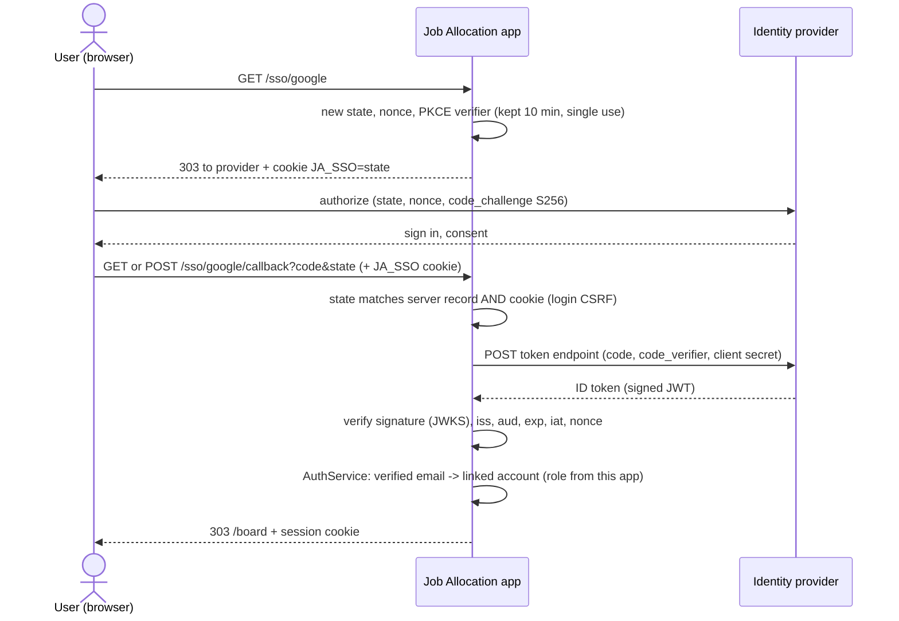

# Single Sign-On (Google, Microsoft, Apple, any OpenID Connect provider)

Users can sign in with an existing Google, Microsoft (Entra ID) or Apple account, or through any OpenID Connect provider such as Okta or Keycloak. Password sign-in stays available.

## How it works



The UML version is `../diagrams/src/30-sso-sequence.puml`.

| Security check | Stops |
|---|---|
| `state`, single use, bound to the browser by the `JA_SSO` cookie | Login CSRF and replayed callbacks |
| `nonce` inside the ID token | Token replay and injection |
| PKCE (S256) | A stolen authorization code being redeemed |
| Signature against the provider's published keys; only RS256/ES256 | Forged tokens, `alg: none`, algorithm confusion |
| `iss`, `aud`, `exp`, `iat` | Tokens from another provider, for another app, or expired |
| Provider endpoints must be HTTPS | Downgrade to plain HTTP |
| Email must be **verified** by the provider | Account takeover by registering someone else's email |
| Roles come from this app, never from the provider | Privilege escalation through the identity provider |

## Account linking

- An SSO sign-in links to the account whose **email** matches the provider's verified email (case-insensitive). Since migration V4, accounts have an email column; the demo accounts use `supervisor@example.com` and `viewer@example.com`.
- **Unknown email:** denied by default. With `SSO_AUTO_PROVISION=viewer`, a read-only Viewer account is created (username `provider:subject`, no password). **SSO never creates a Supervisor.**
- To give a real person access: an administrator creates the account with that person's email (or sets the email on an existing account). Then they can use either SSO or a password.

## Configuration

Providers are switched on by setting their client id. Client **secrets** are injected at deploy time; they may never be committed (policy P9 and the secret scan both enforce this).

| Setting | Example | Notes |
|---|---|---|
| `SSO_BASE_URL` | `https://jobs.example.edu` | The public URL users reach. Redirect URIs are `SSO_BASE_URL/sso/<provider>/callback`. Production must be `https://` (policy P9) |
| `SSO_AUTO_PROVISION` | `none` | `none` (deny unknown emails) or `viewer` |
| `SSO_GOOGLE_CLIENT_ID` / `_SECRET` | | Google Cloud OAuth client |
| `SSO_MICROSOFT_CLIENT_ID` / `_SECRET` / `_TENANT` | tenant `organizations` | Entra ID app registration; a tenant id restricts sign-in to one organisation |
| `SSO_APPLE_CLIENT_ID`, `_TEAM_ID`, `_KEY_ID`, `_PRIVATE_KEY_FILE` | | Apple Services ID and a Sign in with Apple key (.p8 file, never committed) |
| `SSO_OIDC_NAME`, `_ISSUER`, `_CLIENT_ID`, `_CLIENT_SECRET` | | Any other OpenID Connect provider (uses its discovery document) |

## Try it on your laptop (step by step)

The sign-in page shows a provider's button only when that provider is configured, so with a fresh checkout you see the password form alone. To try single sign-on locally:

1. **Register the app** with Google and/or Microsoft (next section). Use these redirect URIs, which both providers accept over plain `http` because they are loopback addresses:
   - `http://127.0.0.1:8080/sso/google/callback`
   - `http://127.0.0.1:8080/sso/microsoft/callback`
2. **Put the settings in `app/.env`** (git-ignored, read by `make run`, skipped by the secret scan, so real secrets may live there on your own laptop):

   ```bash
   SSO_BASE_URL=http://127.0.0.1:8080
   SSO_GOOGLE_CLIENT_ID=<client id>.apps.googleusercontent.com
   SSO_GOOGLE_CLIENT_SECRET=           # paste the client secret after the '='
   SSO_MICROSOFT_CLIENT_ID=<application (client) id>
   SSO_MICROSOFT_CLIENT_SECRET=        # paste the client secret value after the '='
   SSO_MICROSOFT_TENANT=organizations
   ```
3. **Link your account.** Sign-in links by verified e-mail, and the demo accounts use `@example.com` addresses, so give one of them your real address:
   - PostgreSQL: `make db-psql`, then `update app_user set email = 'you@gmail.com' where username = 'supervisor';`
   - In-memory storage: change the e-mail of the `supervisor` row in `src/main/resources/db/memory/users.csv` (local only; do not commit your address).
   - Or set `SSO_AUTO_PROVISION=viewer` in `.env` to let an unknown address in as a read-only Viewer.
4. **Restart** with `make run` and open `http://127.0.0.1:8080`, exactly this host: the redirect URI must match, and `localhost` is a different host to the providers. The log line `Starting Job Allocation … sso=[google, microsoft]` shows which providers are on.

**Apple** needs HTTPS and a domain you have verified with Apple, even for testing, so it cannot run on `127.0.0.1`. Use a deployed instance with a real certificate (or an HTTPS tunnel to your laptop whose domain you register with Apple).

## Registering the app with each provider

The redirect URI is always `SSO_BASE_URL/sso/<provider>/callback`. For local testing, use `http://127.0.0.1:8080`; Google and Microsoft accept `http` for loopback addresses.

### Google
1. Google Cloud Console → APIs & Services → OAuth consent screen: set the app name and support email; add the scopes `openid`, `email` and `profile`.
2. Credentials → Create credentials → OAuth client ID → Web application.
3. Authorised redirect URI: `https://jobs.example.edu/sso/google/callback`.
4. Set `SSO_GOOGLE_CLIENT_ID`, and `SSO_GOOGLE_CLIENT_SECRET` from your secret store.

### Microsoft (Entra ID)
1. Entra admin centre → App registrations → New registration. For "Supported account types", choose your organisation or "any organisational directory".
2. Redirect URI (Web): `https://jobs.example.edu/sso/microsoft/callback`.
3. Certificates & secrets → New client secret. Store it as `SSO_MICROSOFT_CLIENT_SECRET`.
4. Token configuration → Add optional claim → ID token → **`email`** and **`xms_edov`**. The app links accounts only when Microsoft marks the email domain as verified (`xms_edov`). Without it, SSO sign-ins safely fail to link.
5. Set `SSO_MICROSOFT_CLIENT_ID` and `SSO_MICROSOFT_TENANT` (your tenant id, or `organizations`).

### Apple
1. Apple Developer → Certificates, IDs & Profiles → Identifiers → **Services ID** (this is `SSO_APPLE_CLIENT_ID`). Enable Sign in with Apple and add the domain and return URL `https://jobs.example.edu/sso/apple/callback`. Apple requires HTTPS, even for testing.
2. Keys → create a key with Sign in with Apple enabled. Download the `.p8` file (once only). Its Key ID is `SSO_APPLE_KEY_ID`; your Team ID is `SSO_APPLE_TEAM_ID`.
3. Store the `.p8` file outside the project, readable only by the app, and set `SSO_APPLE_PRIVATE_KEY_FILE` to its path.
4. Apple returns with a cross-site form POST (`response_mode=form_post`). The `JA_SSO` cookie is therefore `SameSite=None; Secure` when `COOKIE_SECURE=true`, which is required for Apple.
5. Users may hide their email; Apple then gives a private relay address (`…@privaterelay.appleid.com`). To link it, set it as the account's email, or use `SSO_AUTO_PROVISION=viewer`.

## Testing

- `IdTokenVerifierTest` covers every ID-token check and attack: wrong key, wrong audience, expired token, wrong nonce, edited claims, `alg: none`, HS256, Apple ES256 tokens and the Apple client secret.
- `SsoAccountLinkingTest` covers the linking rules: verified only, unknown email denied, auto-provisioning creates only a Viewer, roles come from the app.
- `SsoIT` runs the whole flow over HTTP against `FakeIdentityProvider` (a real OIDC provider in the test): success, unverified email, unknown email, missing state cookie, a replayed callback, and a token from another key. It runs on PostgreSQL, MySQL and in-memory storage.
- **Before production:** sign in once with each real provider, have a second person review the `web.sso` package, and run a manual penetration test of the sign-in flow.
