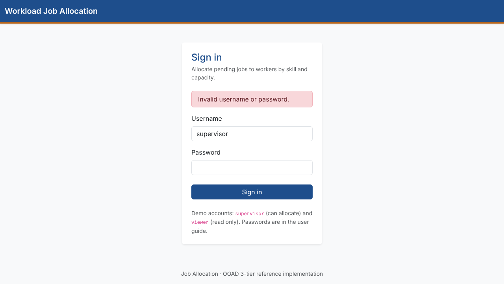
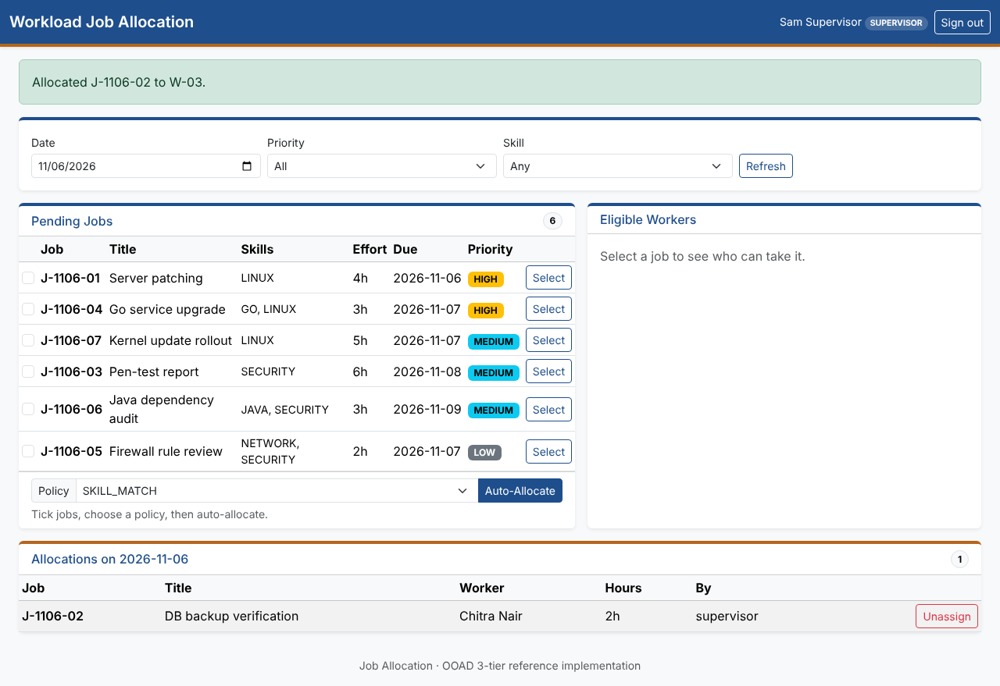
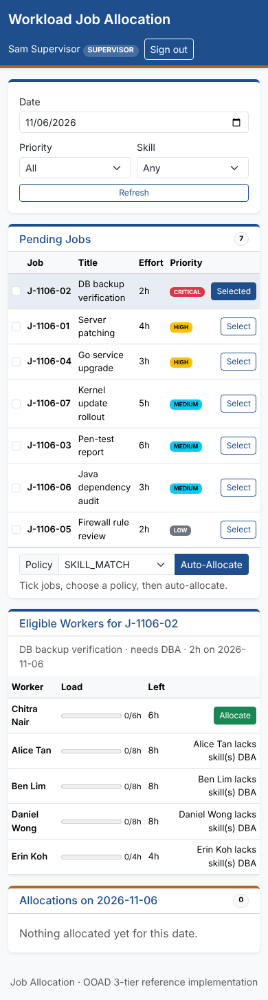

# User Guide — Job Allocation Board

For supervisors who allocate work and viewers who follow it.

## Signing in

Open the board (by default `http://127.0.0.1:8080`) and sign in.

| Account | Password | Can do |
|---|---|---|
| `supervisor` | `Supervisor#2026` | Everything: allocate, auto-allocate, unassign |
| `viewer` | `Viewer#2026` | Read only: browse jobs, workers and allocations |

These are classroom demo accounts. Change the passwords before using the app anywhere else; the [runbook](runbook.md#7-change-a-user-password) shows how.

After 5 wrong passwords in a row an account is locked for 5 minutes. The error message never says whether the username or the password was wrong.

A wrong password shows the same red message whichever part was wrong:



### Signing in with Google, Microsoft or Apple

If your administrator has set up single sign-on, the sign-in page also shows **Sign in with Google**, **Sign in with Microsoft** and/or **Sign in with Apple**. Click one, sign in at that provider, and you return to the board.

- Your provider account is linked to your app account by its **verified e-mail address**. If no app account has that address, you are signed in as a new **viewer** only if the administrator allows it; otherwise ask the administrator to add your e-mail to your account.
- Single sign-on never makes you a supervisor; an administrator grants that role.
- "Single sign-on failed. Please try again or sign in with your password." means the provider sign-in was cancelled, took too long (10 minutes), or could not be verified. Start again from the sign-in page.

Sessions end after 30 minutes without activity, or when you click **Sign out**.

## The board



| Area | Shows |
|---|---|
| **Filters** | Date (defaults to today), priority and skill. Click **Refresh** to apply. |
| **Pending Jobs** | Jobs waiting for a worker on that date, most urgent first (CRITICAL → LOW, then earliest due date). The **Skills** column lists the skills a job requires; a job that needs none shows *no specific skill (any worker)*, and any worker with enough hours left can take it. |
| **Eligible Workers** | After you **Select** a job: every worker, the ones who can take it first, with their load and hours left. Workers who can't take it show the reason. |
| **Allocations** | Everything allocated for the date, who did it, and an **Unassign** button. |

## Allocate a job to a worker

1. In **Pending Jobs**, click **Select** on the job.
2. In **Eligible Workers**, the best match is listed first. Click **Allocate** on the worker you want.
3. A green message confirms the allocation. The job moves from Pending Jobs to Allocations.

A worker can take a job only if all three hold:
- they have **every skill** the job requires;
- their **hours left** on the job's date are at least the job's effort;
- the job is still **pending**.

## Auto-allocate several jobs

1. Tick the boxes next to the jobs in **Pending Jobs**.
2. Choose a **Policy**:

   | Policy | Picks |
   |---|---|
   | `SKILL_MATCH` (default) | The worker whose skills match the job most closely, so specialists stay free for specialist work |
   | `LEAST_LOADED` | The worker with the most hours left that day, to balance workload |
   | `FIRST_FIT` | The first eligible worker by ID (a simple baseline to compare against) |

3. Click **Auto-Allocate**. The message lists how many jobs were allocated and why any were not (for example, nobody has the required skill).

Jobs are processed most urgent first, so a CRITICAL job gets first pick of the workers.

## Using the board on a phone or tablet

The board works on any screen width; no app install is needed.

| Screen width | Layout |
|---|---|
| Wide (1200 px and up) | Pending Jobs and Eligible Workers side by side, Allocations below |
| Tablet (768–1199 px) | Panels stacked; all columns shown |
| Phone (under 768 px) | Panels stacked; **Skills** and **Due** columns hidden to save space, filters stack, buttons stay in view |

If a table is still wider than the screen, swipe sideways **inside that panel**; the page itself never scrolls sideways.



## Unassign

In **Allocations**, click **Unassign**. The job returns to Pending Jobs and the worker's hours are freed.

## Messages you may see

| Message | Meaning | What to do |
|---|---|---|
| "… lacks skill(s) …" / "… has Nh left …" | The worker can't take this job | Pick another worker |
| "… was changed by someone else … Refresh and retry." | Another supervisor changed the job or worker after you loaded the page | Click **Refresh**, then try again |
| "Job … is ALLOCATED, not PENDING" | The job was already allocated | Refresh the board |
| Error 403 | Your account can't do that (viewers can't change data), or the page expired | Sign in as a supervisor, or reload the page |
| Error 403 on the sign-in page | The sign-in form had expired or was submitted from another site | Reload the sign-in page and sign in again |

Every allocation and unassignment is recorded in an audit trail that can't be edited.

## REST API (for integrations)

The same operations are available as JSON under `/api/v1`, authenticated with HTTP Basic:

```bash
curl -u supervisor:'Supervisor#2026' http://127.0.0.1:8080/api/v1/jobs
curl -u supervisor:'Supervisor#2026' http://127.0.0.1:8080/api/v1/jobs/J-1105-01/eligible-workers
curl -u supervisor:'Supervisor#2026' -H 'Content-Type: application/json' \
     -d '{"jobId":"J-1105-01","workerId":"W-02","jobVersion":0}' http://127.0.0.1:8080/api/v1/allocations
```

The `jobVersion` must be the `version` from the job listing; if the job changed since, the API answers `409 Conflict`. Endpoints and status codes are listed in [architecture.md §5](architecture.md#5-traceability-ui--api--service--domain--dao).
