<!-- _class: lead -->
<!-- _paginate: false -->
<!-- _footer: "" -->

###### Object-Oriented Analysis & Design

# UI-Driven OOAD for a<br>3-Tier Web Application

Case study: **Workload Job Allocation**

Presentation · UI Service  |  Business · Domain Objects  |  Persistence · DAO

UML 2.5.1 · PlantUML diagrams-as-code

---

###### Session overview

## Learning outcomes

1. Distinguish **logical layers** from **physical tiers** in a 3-tier web app.
2. Derive system operations, DTOs and service contracts from a **UI wireframe**.
3. Assign responsibilities to domain objects with **GRASP** and model them in UML 2.5.1.
4. Identify design smells and apply **design patterns**, comparing the design before and after.
5. Design a **DAO** persistence layer and trace every UI action down to the database.

---

###### Concept

## Layers organise code; tiers deploy it

| Logical layers (code) | Physical tiers (deployment) |
|---|---|
| **UI Service**: controllers, DTOs, validation | **Tier 1**: browser + web / UI service node |
| **Business**: services, domain objects, policies | **Tier 2**: application server |
| **Persistence**: DAO interfaces and implementations | **Tier 3**: database server |

> Dependencies point **downward only**. The DAO layer runs inside the application server; only the DBMS is a separate physical node.

---

###### The method

## Eight steps from screen to database

| # | Step | What you do | Output |
|---|---|---|---|
| 1 | Use cases & storyboard | Name the actor goal; sketch the screen | Use-case brief, wireframe |
| 2 | UI events → system operations | Ask what the system must do for each control | System sequence diagram |
| 3 | View models (DTOs) | List what each screen region shows or sends | `JobSummaryDTO`, `AllocateRequestDTO` |
| 4 | UI Service (controller / BFF) | Map operations to endpoints; validate; authorise | REST endpoints, OpenAPI |
| 5 | Operation contracts | Write pre- and post-conditions | Contracts = test oracles |
| 6 | Domain model + GRASP | Give behaviour to the objects that own the data | Class diagram |
| 7 | Persistence (DAO) | One DAO per aggregate; optimistic locking | DAO interfaces, schema |
| 8 | Traceability check | Trace UI → API → service → domain → DAO | Traceability matrix |

---

###### Steps 1–2

## Start from the screen: every control becomes an operation

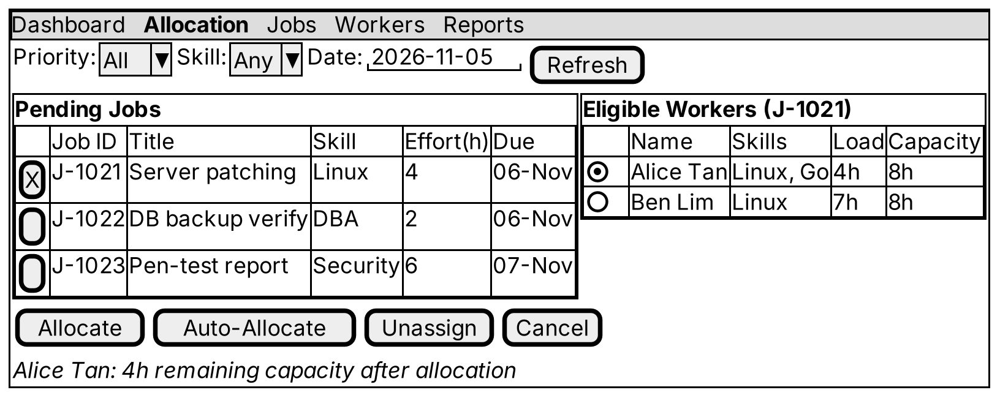

| UI event | System operation |
|---|---|
| Load / [Refresh] | `getPendingJobs(filter)` |
| Select job row | `getEligibleWorkers(jobId)` |
| [Allocate] · [Auto-Allocate] · [Unassign] | `allocate(jobId, workerId, version)` · `autoAllocate(jobIds)` · `unassign(allocationId)` |

---

###### Step 1 · UML 2.5.1 use case diagram

## Who does what: actors and use cases

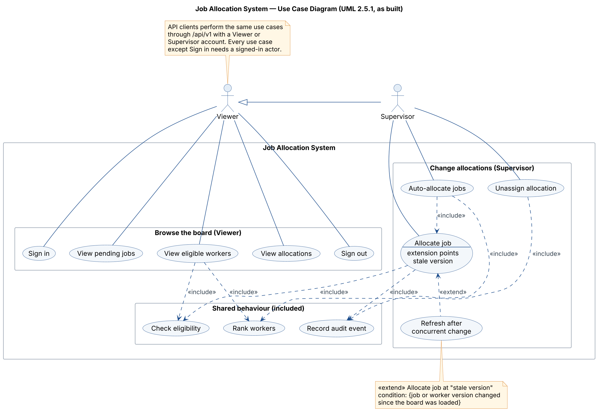

---

###### Steps 3–4

## The UI Service translates; it does not decide

### View (boundary)
Renders the job and worker grids, captures selections, shows results or errors. No business rules.

### UI Service (controller / BFF)
Maps UI events to REST endpoints. Validates input, authenticates, authorises, maps DTOs ↔ domain, turns exceptions into 409 / 422.

### DTOs
Shaped by what the screen shows, not by the tables. Carry the job version for optimistic locking. Never expose entities.

> **Keep out of the UI Service:** allocation rules, capacity checks and SQL.

---

###### Step 5

## Operation contract: `allocate()`

`allocate(jobId, workerId, jobVersion, actor) : Allocation`

| Pre-conditions | Post-conditions |
|---|---|
| Job exists and status = PENDING | Allocation created (ACTIVE), linked to Job and Worker |
| Worker has every required skill | `Job.status` = ALLOCATED; version incremented |
| Remaining capacity ≥ job effort | Audit event JOB_ALLOCATED appended |
| Actor holds the SUPERVISOR role | On any failure: no state change → 409 / 422 |
| `jobVersion` matches the stored version | |

---

###### Step 6

## Assign responsibilities with GRASP

| Principle | Decision in this design |
|---|---|
| **Information Expert** | Worker knows its skills and load → `Worker.canTake(job)` |
| **Creator** | Worker holds its allocations → `Worker.assign()` creates the Allocation |
| **Controller** | `AllocationController` / `AllocationService` receive system operations |
| **Polymorphism** | `AllocationPolicy` varies the ranking rule |
| **Pure Fabrication** | DAO classes exist for persistence, not the domain |
| **Low Coupling** | Interfaces between tiers: `AllocationService`, `JobDAO`, `WorkerDAO` |

---

###### UML 2.5.1 · Class diagram

## Domain model: behaviour lives with the data

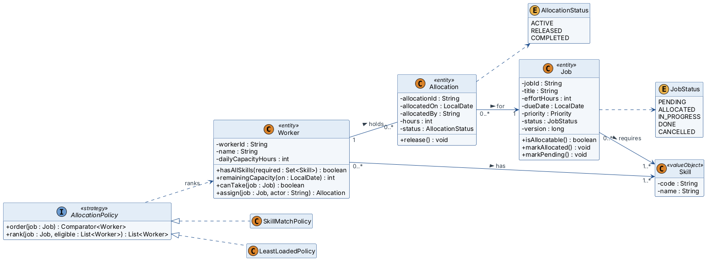

Worker owns capacity and assignment rules; `AllocationPolicy` is the variation point.

---

###### UML 2.5.1 · Class diagram

## All three tiers in one class view

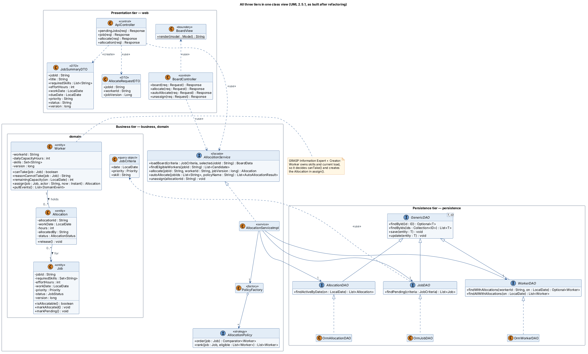

---

###### UML 2.5.1 · Component diagram

## Components connect only through interfaces

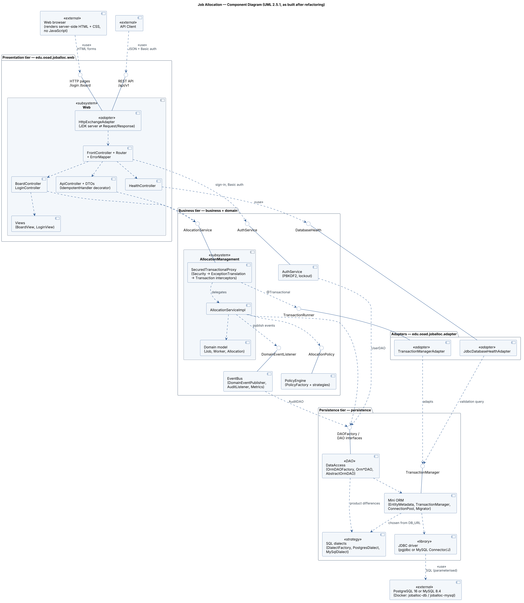

<!-- _class: compact -->

**Presentation**: `FrontController` + `Router` provide the HTML pages and the REST API; controllers call only the `AllocationService` interface.

**Business**: `SecuredTransactionalProxy` provides `AllocationService` and delegates to `AllocationServiceImpl`; policies and events plug in through `AllocationPolicy` and `DomainEventListener`.

**Persistence**: `DataAccess` provides the DAO interfaces; the mini ORM provides transactions; a `SqlDialect` covers product differences; JDBC talks to PostgreSQL (or MySQL) in Docker.

Lollipop = provided interface · dashed arrow = required (`«use»`).

---

###### UML 2.5.1 · Sequence diagram

## Allocate: from click to commit

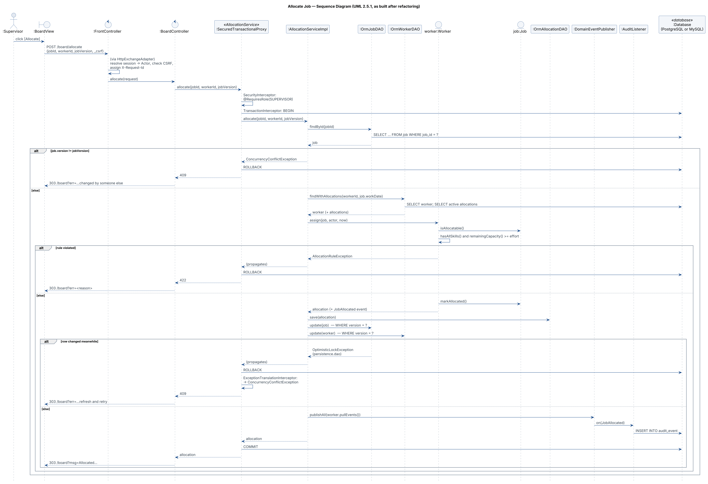

Three outcomes: 201 Created, 409 Conflict (stale version), 422 rule violation.

---

###### UML 2.5.1 · Activity diagram

## Allocate: decisions and outcomes

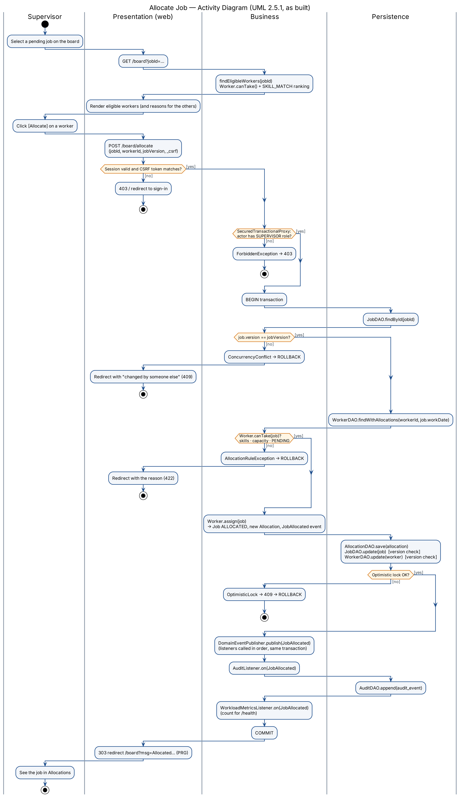

Swimlanes follow the tiers: **Supervisor · Presentation · Business · Persistence**.

| Check | Fails with |
|---|---|
| Session and CSRF token | 403 / sign-in |
| Role is SUPERVISOR (proxy) | 403 |
| Job version unchanged | 409, rollback |
| Skills, capacity, job PENDING | 422, rollback |
| Optimistic lock on job and worker | 409, rollback |

On success: allocation saved → `JobAllocated` published → audit row written → **COMMIT** → POST-Redirect-GET.

---

###### Architecture · Layers

## Three layers, dependencies point down

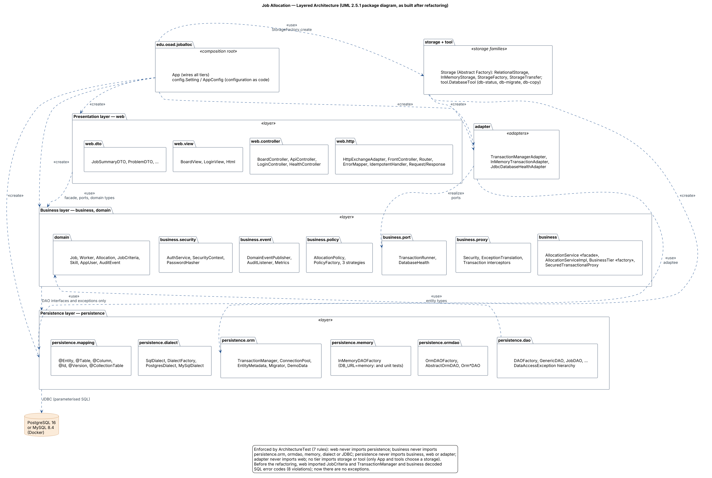

**Presentation**: `web.http`, `web.controller`, `web.view`, `web.dto`

**Business**: `AllocationService` facade, policies, events, security, domain

**Persistence**: DAO interfaces, ORM DAOs, mini ORM, migrations

**No exceptions**: the business tier owns **ports** (`TransactionRunner`, `DatabaseHealth`); **adapters** outside the layers implement them (Dependency Inversion)

> Enforced by `ArchitectureTest` on every build: 5 layer rules, no JDBC in business.

---

###### Architecture · Deployment

## Where each tier runs (as built)

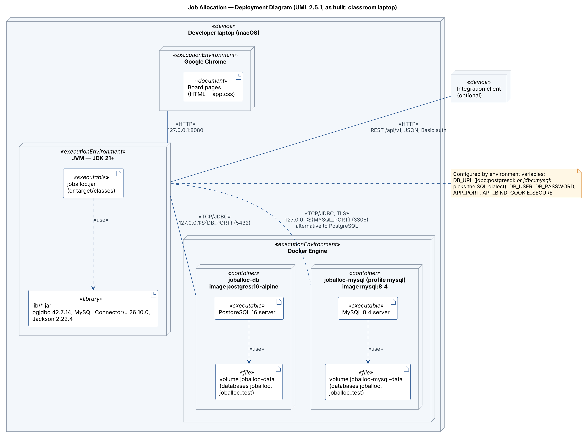

**Tier 1**: Chrome renders server-side HTML; no JavaScript

**Tier 2**: `joballoc.jar` on the JVM, bound to `127.0.0.1:8080`

**Tier 3**: PostgreSQL 16 (or MySQL 8.4) in Docker; data in a named volume

Configuration comes from environment variables, never from code.

---

###### Architecture · C4 level 1

## System context: who uses the system

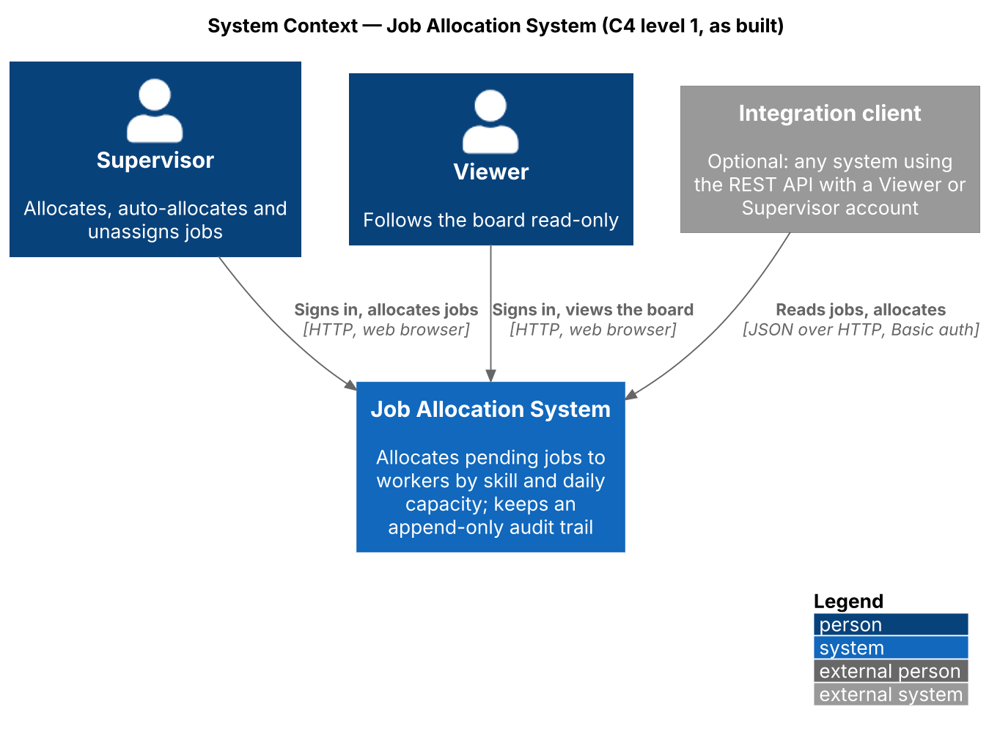

---

###### Architecture · C4 level 2

## Containers: the three tiers

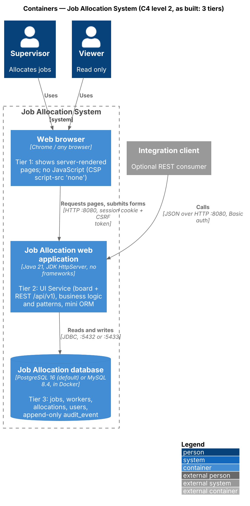

| C4 container | Tier | Technology |
|---|---|---|
| Web browser | 1 · Presentation | HTML + CSS |
| Web application | 2 · Business | Java 21, JDK HttpServer |
| Database | 3 · Persistence | PostgreSQL 16 or MySQL 8.4 |

**Discuss:** why is the browser a tier but not a separate deployable?

---

###### Architecture · C4 level 3

## Components inside the web application

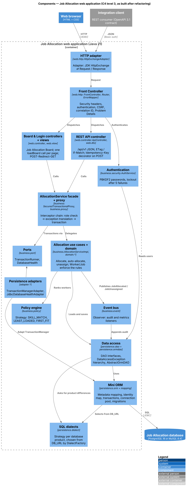

Each C4 component maps to one or more Java packages.

Read the arrows top to bottom: request → controller → facade → use case → DAO → ORM → SQL.

**Compare** with the UML component diagram: C4 shows *responsibilities*; UML shows *provided and required interfaces*.

---

###### Design patterns · Start here

## Where every pattern lives: the system in context

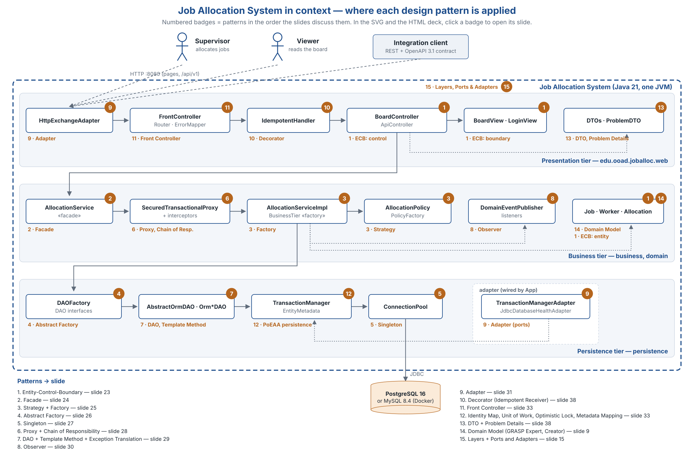

<!-- _class: patternindex -->

| # | Pattern | Slide |
|---|---|---|
| 1 | [Entity-Control-Boundary](#23) | 23 |
| 2 | [Facade](#24) | 24 |
| 3 | [Strategy + Factory](#25) | 25 |
| 4 | [Abstract Factory](#26) | 26 |
| 5 | [Singleton](#27) | 27 |
| 6 | [Proxy + Chain of Responsibility](#28) | 28 |
| 7 | [DAO + Template Method](#29) | 29 |
| 8 | [Observer](#30) | 30 |
| 9 | [Adapter](#31) | 31 |
| 10 | [Decorator (Idempotent Receiver)](#38) | 38 |
| 11 | [Front Controller](#33) | 33 |
| 12 | [Identity Map · Unit of Work · Optimistic Lock](#33) | 33 |
| 13 | [DTO + Problem Details](#38) | 38 |
| 14 | [Domain Model (GRASP)](#9) | 9 |
| 15 | [Layers + Ports & Adapters](#15) | 15 |

---

###### Design patterns · Identify

## Spot the smell, then choose the pattern

| Smell in the naive design | Pattern | Family | Applied as |
|---|---|---|---|
| UI, rules and SQL tangled in one handler | ECB | Analysis (Jacobson) | Boundary / Control / Entity |
| Controller orchestrates many DAOs | Facade | GoF structural | `AllocationService` |
| `switch` on the allocation rule | Strategy | GoF behavioural | `AllocationPolicy` |
| `new JdbcXxxDAO()` inside services | Abstract Factory | GoF creational | `DAOFactory` |
| A new DB connection per call | Singleton | GoF creational | `ConnectionPool` |
| Auth and transaction code repeated | Proxy | GoF structural | `SecuredTransactionalProxy` |
| SQL in business code; JDBC boilerplate | DAO + Template Method | PoEAA + GoF | `JobDAO`, `AbstractOrmDAO` |
| Side effects hard-wired into `allocate()` | Observer | GoF behavioural | `JobAllocated` listeners |

---

###### Design patterns · Identify (after the first version)

## Smells found while refactoring, and three more patterns

| Smell in the first version | Pattern | Family | Applied as |
|---|---|---|---|
| Framework or ORM types leak across layers | Adapter | GoF structural | `HttpExchangeAdapter`, `TransactionManagerAdapter` |
| A retried POST could book twice | Decorator | GoF structural | `IdempotentHandler` |
| One proxy doing three jobs | Chain of Responsibility | GoF behavioural | Security → ExceptionTranslation → Transaction interceptors |

These patterns arrived **because** a smell appeared, not because they are in the catalogue.

---

###### Design pattern 1 of 8 · Analysis pattern

## ECB: separate what the user sees, decides and stores

**Before · the smell**: one page handler reads the form, checks capacity and writes SQL.

```js
onAllocateClick(e) {
  w = sql("SELECT * FROM worker")
  if (w.load + job.h > 8) alert()
  sql("INSERT INTO allocation..")
  sql("UPDATE job SET status..")
}
```

**After · ECB applied**

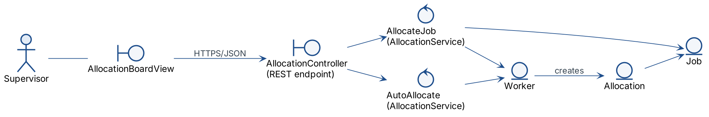

> **Discuss:** Is `AllocationController` a boundary or a control object?

---

###### Design pattern 2 of 8 · GoF structural

## Facade: one entry point into the allocation subsystem

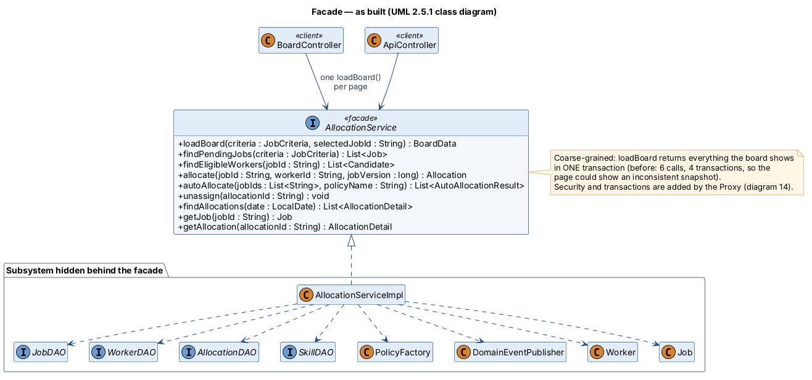

**Before · the smell**: the controller orchestrates the DAOs and the transaction.

```java
job = jobDao.findById(id)
w = workerDao.find(wid, today)
tx.begin(); allocDao.save(w.assign(job))
jobDao.update(job); auditDao.append(evt)
tx.commit()
```

**After**: controllers call one coarse-grained interface.

> **Discuss:** When does a facade become a "God service"?

---

###### Design pattern 3 of 8 · GoF behavioural

## Strategy: swap rules without editing the service

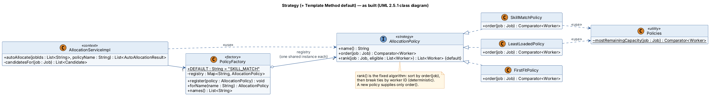

**Before · the smell**: a new branch for every department's rule, which breaks Open/Closed.

```java
switch (policyName) {
  case "SKILL": // rank by skill
  case "LOAD":  // rank by load
  case "DUE":   // rank by due
  // next request: edit again
}
```

**After**: each rule is a class behind `AllocationPolicy`.

> **Discuss:** Who chooses the policy: user, configuration, or department?

---

###### Design pattern 4 of 8 · GoF creational

## Abstract Factory: a matching family of DAOs

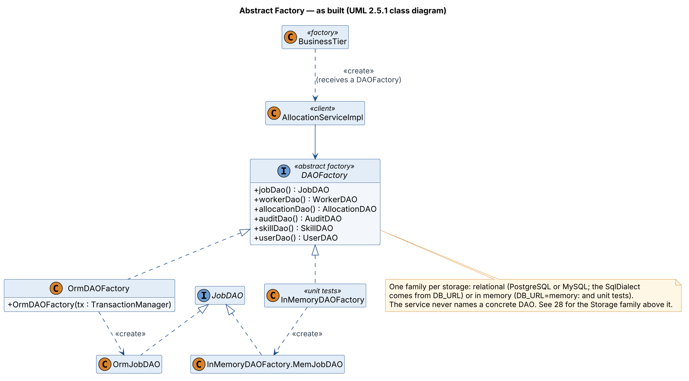

**Before · the smell**: concrete DAOs are created with `new`, so tests need a live database.

```java
class AllocationServiceImpl {
  jobDao = new JdbcJobDAO(ds)
  workerDao = new JdbcWorkerDAO(ds)
  allocDao = new JdbcAllocDAO(ds)
}
```

**After**: swap JDBC for in-memory in one place.

> **Discuss:** Factory or DI container: what does each cost?

---

###### Design pattern 5 of 8 · GoF creational

## Singleton: one shared connection pool

**Before · the smell**: each DAO call opens its own connection, and the DB runs out under load.

```java
Connection c = DriverManager.getConnection(url, user, password);
// per call, per DAO, per thread
```

**After · Singleton applied**

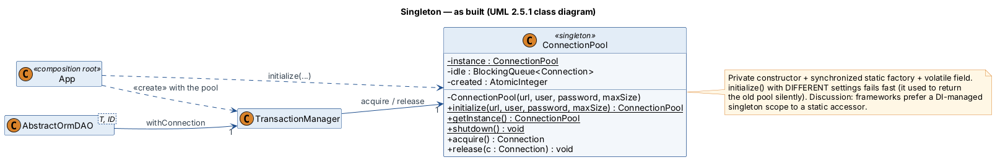

> **Discuss:** Why do frameworks prefer a DI-managed singleton scope to a static `getInstance()`?

---

###### Design pattern 6 of 8 · GoF structural

## Proxy: security and transactions without touching business code

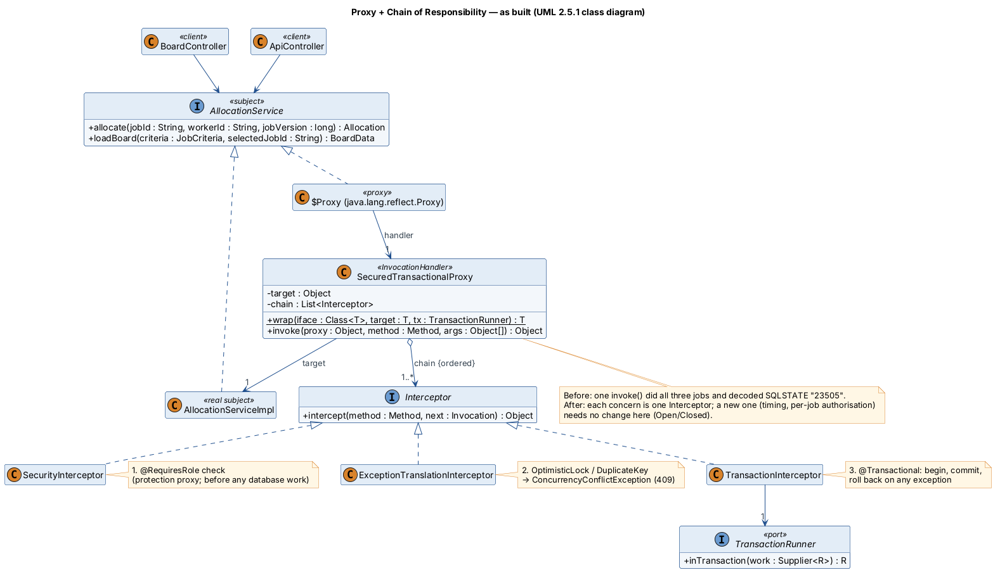

<!-- _class: compact -->

**Before · the smell**: every service method repeats authorisation and transaction code.

```java
allocate(..) {
  if (!authz.can(actor, job))
    throw Forbidden
  tx.begin()
  try { ...; tx.commit() }
  catch (e) { tx.rollback() }
}
```

**After**: an **interceptor chain**: role check → exception translation → transaction.

> **Discuss:** Where would protection, virtual or caching proxies help?

---

###### Design pattern 7 of 8 · PoEAA + GoF behavioural

## DAO + Template Method: isolate SQL, remove boilerplate

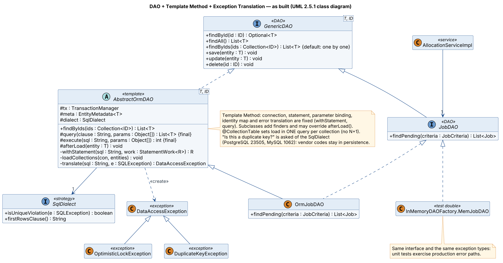

<!-- _class: compact -->

**Before · the smell**: every DAO repeats open, bind, execute, map and close.

```java
ps = conn.prepareStatement(sql)
ps.setString(1, id)
rs = ps.executeQuery()
while (rs.next()) { map row }
rs.close(); ps.close()
```

**After**: `AbstractOrmDAO` fixes the algorithm once; SQL errors become `DataAccessException`.

> **Discuss:** DAO or Repository?

---

###### Design pattern 8 of 8 · GoF behavioural

## Observer: react to allocations without coupling

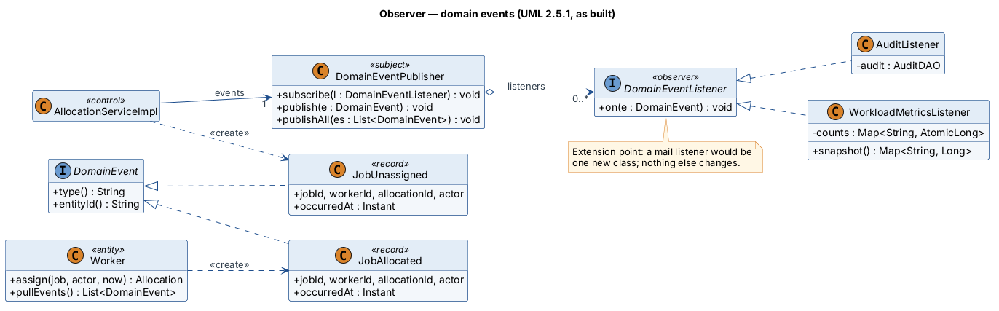

<!-- _class: compact -->

**Before · the smell**: each new side effect edits the core use case.

```java
allocate(..) {
  ...
  auditDao.append(evt)
  mailer.notify(worker)   // next change
  metrics.inc("allocated")
}
```

**After**: the domain raises `JobAllocated`; a new reaction is a new listener. **As built**: `AuditListener`, `WorkloadMetricsListener`.

> **Discuss:** Add a mail listener. Sync or async? What if the e-mail fails?

---

###### Design patterns · Map

## Where the creational and structural patterns live

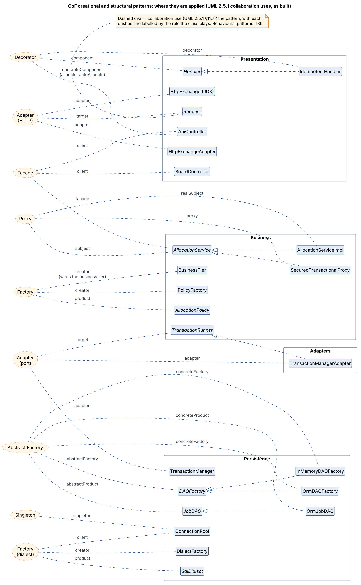

Each dashed oval is a **collaboration use** (UML 2.5.1 §11.7).

The labels on the dashed lines are the **roles** each class plays.

Adapter appears twice: at the HTTP edge and at the persistence port.

---

###### Design patterns · Map

## Where the behavioural patterns live

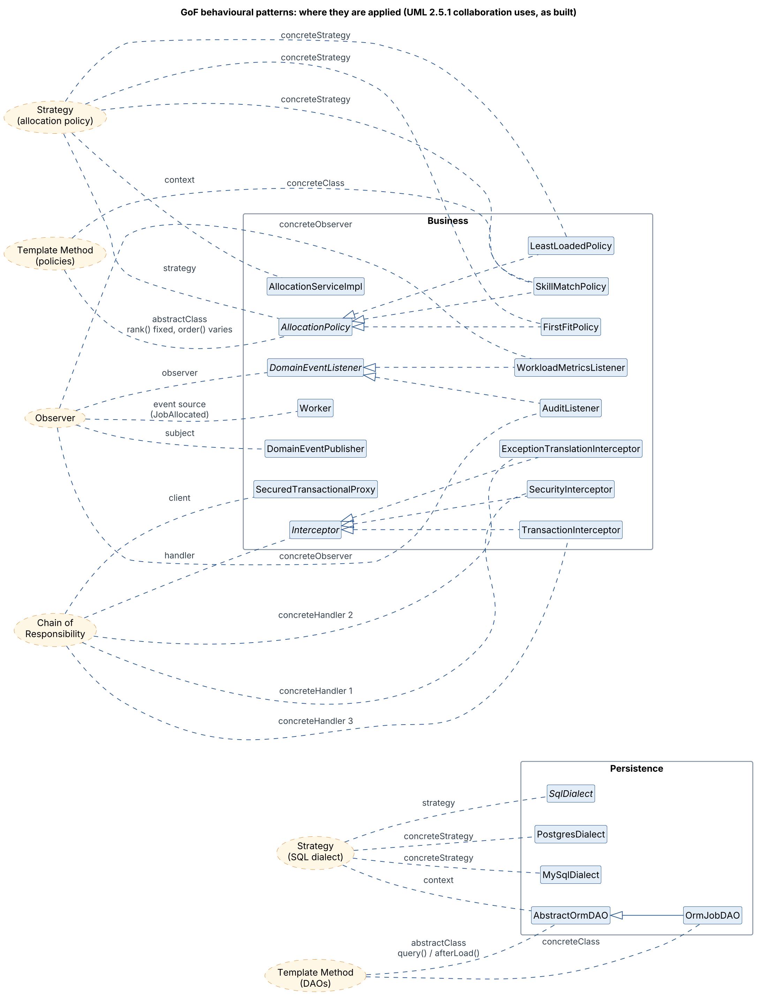

**Template Method** appears twice: `AbstractOrmDAO.query()` and `AllocationPolicy.rank()`.

**Chain of Responsibility** runs inside the Proxy.

---

###### Design patterns · Map

## Enterprise, ECB and GRASP patterns in the code

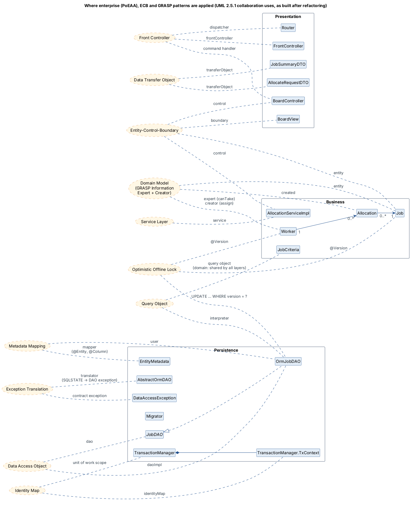

One class can play several roles: `OrmJobDAO` is a DAO implementation, a Metadata Mapping user **and** the optimistic lock writer.

---

###### Design patterns · Pitfalls

## Patterns misapplied become anti-patterns

| Anti-pattern | Symptom | Fix |
|---|---|---|
| **Anemic domain model** | Entities have only getters and setters; rules sit in services | Move `canTake()` and `assign()` into Worker |
| **God facade** | One service with dozens of methods across use cases | Split by use case or bounded context |
| **Singleton abuse** | Hidden global state; hard to test and to run concurrently | Inject a single instance through DI |
| **Pattern-first design** | Patterns added with no smell to remove | Name the force (change, test, reuse) first |

---

###### Class exercise

## Your turn: add "Swap allocation"

A worker hands an active allocation to a colleague with the same skills. The supervisor must approve, and the swap can be undone.

1. **Screen**: sketch the wireframe change and list the new UI events.
2. **Contract**: write the system operations and pre- / post-conditions.
3. **Patterns**: which existing patterns absorb the change? Which new one is needed? *(Hint: undo suggests Command.)*
4. **Models**: update the class and sequence diagrams and the traceability matrix.

---

###### Step 8 · Verify

## Every UI action traces to the database (`/api/v1`)

| UI element | Endpoint | Service op | Domain behaviour | DAO calls |
|---|---|---|---|---|
| Pending Jobs grid | `GET /jobs?status=PENDING` | `findPendingJobs` | — | `JobDAO.findPending` |
| Select job row | `GET /jobs/{id}/eligible-workers` | `findEligibleWorkers` | `Worker.canTake`, `Policy.rank` | `WorkerDAO.findAllWithAllocations` |
| [Allocate] | `POST /allocations` | `allocate` | `Worker.assign` → `Job.markAllocated` | `AllocationDAO.save`, `JobDAO.update` (version check), `AuditDAO.append` via `AuditListener` |
| [Auto-Allocate] | `POST /allocations/auto` | `autoAllocate` | `Policy.rank` → `Worker.assign` | as Allocate |
| [Unassign] | `DELETE /allocations/{id}` | `unassign` | `Allocation.release`, `Job.markPending` | `AllocationDAO.update`, `JobDAO.update` (version check), `AuditDAO.append` via `AuditListener` |

---

###### Refactoring review

## Anti-patterns found in our own code, and the fix

<!-- _class: compact -->

| Anti-pattern | Where it was | Fix (pattern) |
|---|---|---|
| Copy-paste (DRY) | JDBC block ×4, priority parsing ×2, wiring ×2 | Template Method, `RequestBinding`, `BusinessTier` factory |
| Leaky abstraction | Proxy decoded SQLSTATE `23505` | Exception Translation in persistence |
| Layer skipping | Web imported `JobCriteria`, `TransactionManager` | Query Object in domain; Ports + Adapters |
| Chatty facade | 6 calls, 4 transactions per page | Coarse-grained `loadBoard()` |
| N+1 query | One query per allocation | `findByIds` bulk load |
| Shotgun surgery | Two lists of exception → status | `ErrorMapper` table |
| Singleton pitfalls | Silent re-initialisation, connection leak | Fail fast; close and track |
| Dangling link | `Location` to a missing route | `GET /allocations/{id}` |

Full before → after: `app/docs/refactoring-review.md`

---

###### Integration patterns

## A safe retry: Idempotent Receiver over HTTP

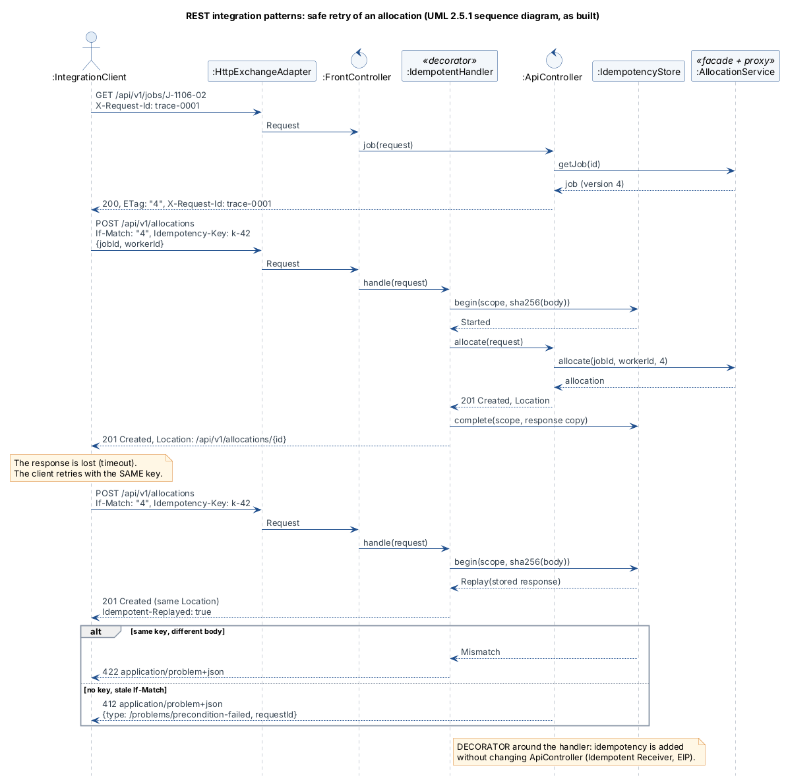

<!-- _class: compact -->

**Contract first**: OpenAPI 3.1, linted by Spectral, checked against the code by a test

**Problem Details** (RFC 9457) for every error

**Correlation ID**: `X-Request-Id` in the response and the log

**Idempotency-Key**: a retry returns the stored response (**Decorator**)

**ETag / If-Match**: the job version, end to end (412)

---

###### Quality · as code

## Every rule is enforced by a tool

| Concern | As code | Gate |
|---|---|---|
| Coding conventions | `.editorconfig`, Checkstyle rules | `make lint` (0 violations) |
| Configuration | `Setting` schema → generated `app.env.example` | `ConfigurationTest`, fail-fast start-up |
| Policy | Rego: containers, configuration, access control | `make policy` (Conftest; policies have tests) |
| API contract | `openapi.yaml` + Spectral house rules | `make api-lint`, `OpenApiContractTest` |
| Architecture | Layer rules | `ArchitectureTest` |

`make check` runs them all without a database, before every commit.

---

###### Quality · Coding conventions

## Formatting and naming: the code reads like the design

<!-- _class: compact -->

| Element | Convention | Example |
|---|---|---|
| Class | `UpperCamelCase` noun + **role suffix** | `BoardController`, `JobSummaryDTO`, `OrmJobDAO` |
| Interface / abstract | the role, no `I` prefix / starts with `Abstract` | `AllocationPolicy`, `AbstractOrmDAO` |
| Method | `lowerCamelCase` verb; booleans ask a question | `assign()`, `canTake(job)` |
| Variable | descriptive noun; collections plural | `remainingHours`, `jobById` |
| Constant | `UPPER_SNAKE_CASE`, no magic numbers | `HOURS_PER_DAY`, `HttpStatus.CONFLICT` |
| Formatting | 4-space indent, 120 columns, K&R braces, break before operators, sorted import groups | Checkstyle (0 violations) |

Enforced by `make lint` (form) and `NamingConventionTest` (role).

---

###### As built · presentation tier

## Responsive UI with Bootstrap CSS, still no JavaScript

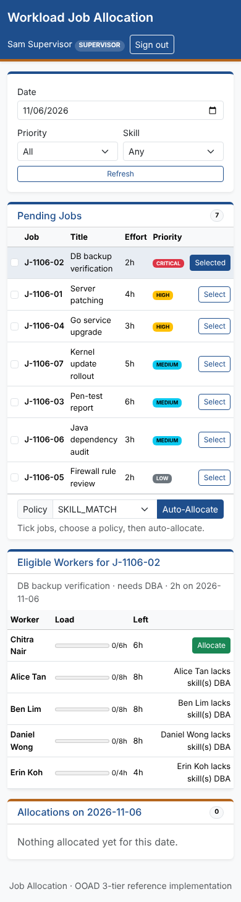

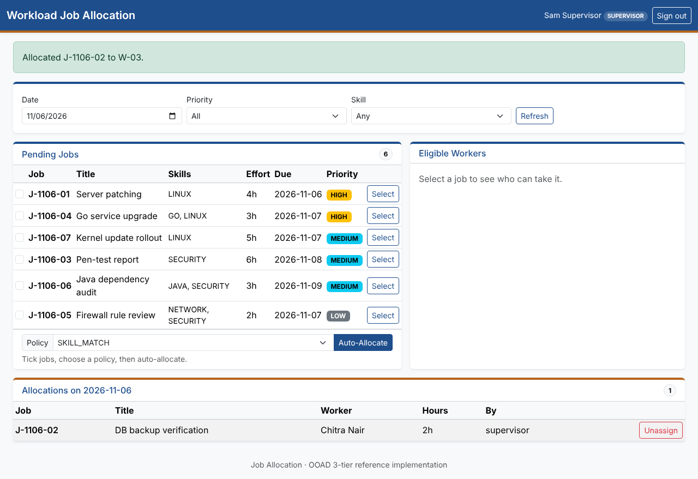

- **Grid:** side by side when wide, stacked on phones
- **CSS only**, SHA-256 pinned: the strict CSP is unchanged
- **Tested:** `StaticAssetsTest` and a 390 px Playwright run

---

###### As built · persistence tier

## One codebase, two databases: Strategy + Factory

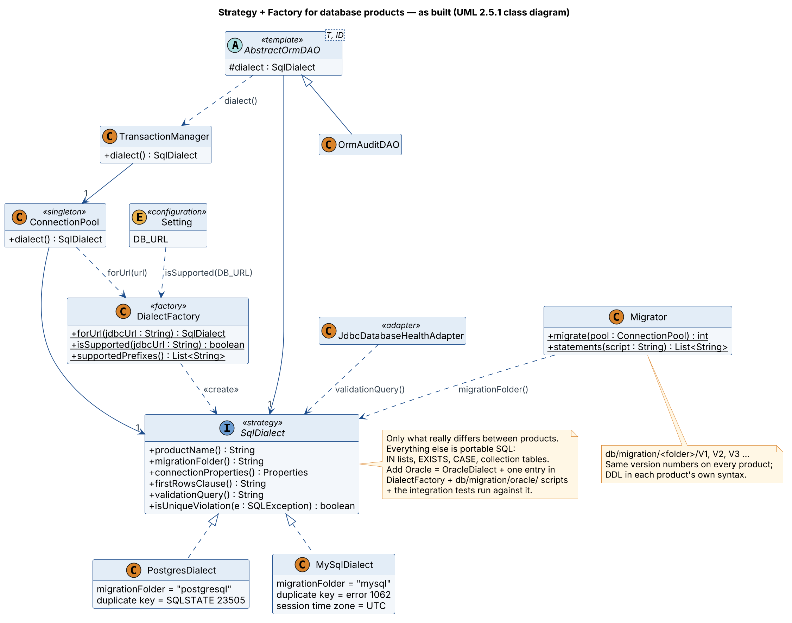

- `DB_URL` prefix → **`DialectFactory`** → `PostgresDialect` or `MySqlDialect`
- The **Strategy** holds only what really differs: scripts folder, duplicate-key code (23505 vs 1062), UTC session, first-rows clause
- Everything else is **portable SQL**: `IN`, `EXISTS`, `CASE`, collection tables
- Same 23 integration and 4 browser tests pass on **both**

---

###### As built · data model

## The schema both databases share

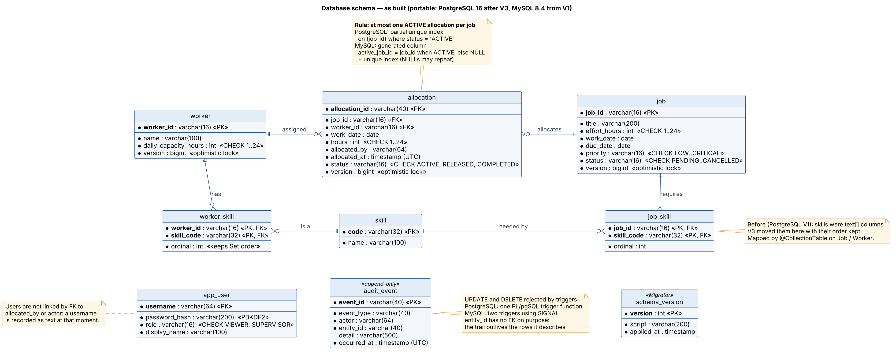

Same rule, product-specific mechanism: *one ACTIVE allocation per job* is a partial unique index on PostgreSQL, a generated column + unique index on MySQL.

---

###### As built · storage families

## Three storages, one switch: `DB_URL`

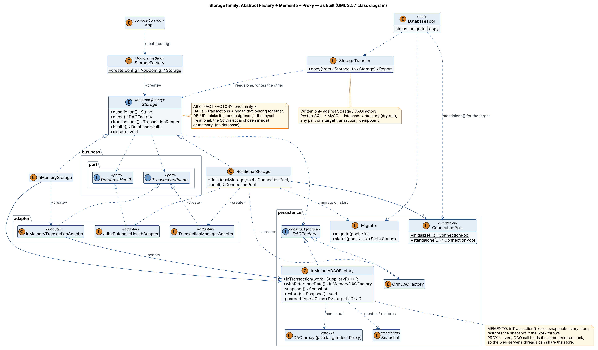

- **Abstract Factory** `Storage`: DAOs + transactions + health that belong together
- `jdbc:postgresql` / `jdbc:mysql` → `RelationalStorage` (+ SQL dialect)
- `memory:` → `InMemoryStorage`: **Memento** rollback, locking **Proxy**
- `StorageTransfer` copies any storage to any other through the DAO interfaces

---

###### Operations

## Release, migrate, roll back

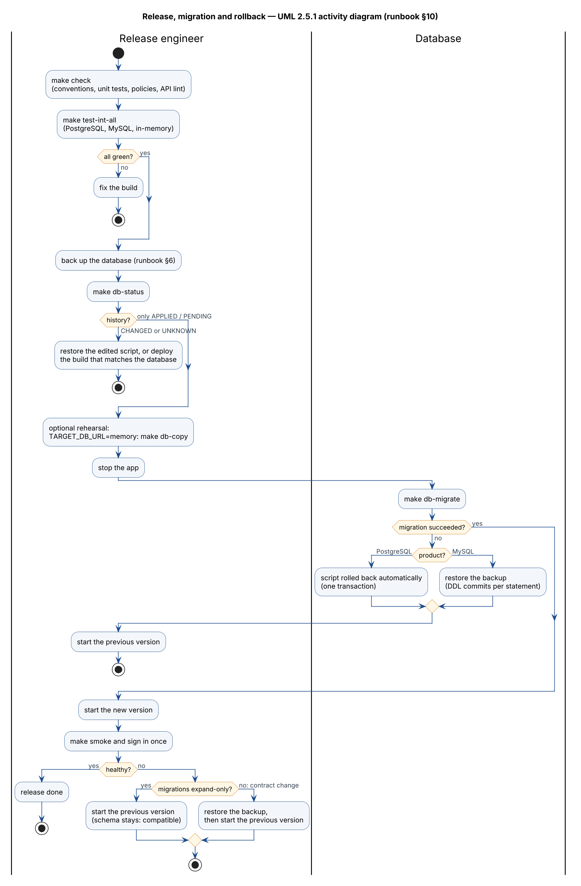

- `make db-status`: applied / pending / **changed** / **unknown** (checksums)
- `make db-migrate`, then start, then `make smoke`
- **Expand first, contract later**: app rollback without a database restore
- Rollback matrix and product switch: runbook §10

---

###### Security · single sign-on

## Single sign-on (OpenID Connect)

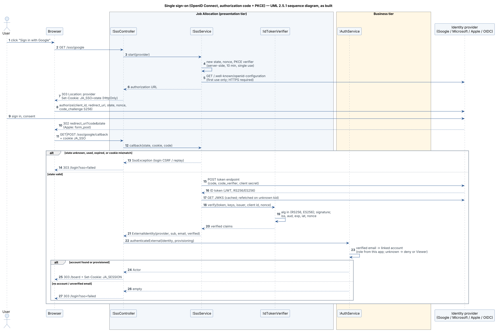

- Google, Microsoft, Apple
- Code flow + **PKCE**, `state`, `nonce`
- ID token signature and claims checked
- Linked by **verified e-mail**
- Never creates a Supervisor

---

###### DevSecOps

## Every gate is a command; every control leaves evidence

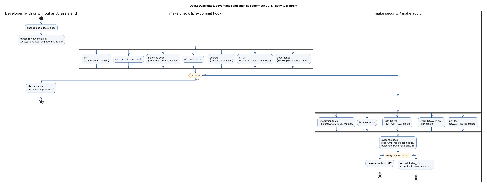

`make check`: tests, policies, **secrets**, **SAST**, governance · `make security`: + **SCA**, **DAST**, **pen test** · `make audit`: 17 controls → evidence pack

---

###### Governance

## AI-assisted engineering: treat AI output as untrusted input

| Risk (examples from the register) | Control in this repository |
|---|---|
| Plausible but wrong or insecure code | Human review checklist; tests, SAST, DAST, pen test |
| Invented or vulnerable dependencies | Pinned SHA-256, SBOM, SCA, licence policy |
| Secrets pasted into prompts or code | Gitleaks gate + pre-commit; secrets only from the secret store |
| A failing gate "fixed" by weakening it | Exceptions need a reason, scope and expiry; listed in the audit pack |
| Nobody knows what was AI-assisted | Disclosure in every pull request (template, governance rule **G8**) |

Frameworks: NIST AI RMF · ISO/IEC 42001 · OWASP Top 10 for LLM Apps · IMDA Model AI Governance Framework (Singapore)

---

###### Quality

## Design controls and how each tier is verified

| Tier | Design control (as built) | Verification (as built) |
|---|---|---|
| UI (View) | Output escaped; CSP `script-src 'none'`; CSRF token on every form | `WebUnitTest`; Playwright end-to-end (4 tests, incl. phone) |
| UI Service | Session login, PBKDF2 passwords, lockout, login CSRF token, OIDC SSO; role check (`@RequiresRole`) in the proxy | `ApiSecurityIT`, `SsoIT`; `SecurityTest`, `IdTokenVerifierTest` |
| Business / Domain | Rules inside `Worker` and `Job`; transaction per facade call | `WorkerTest`, `JobTest`, `AllocationServiceTest`, `PolicyTest` |
| Persistence (DAO) | Parameterised SQL; optimistic locking; append-only audit trigger | `PersistenceIT` against real PostgreSQL **and** MySQL test databases |
| Architecture | Dependencies point downward only; ports and adapters | `ArchitectureTest` (fails the build on a violation) |
| API | OpenAPI contract; Problem Details; idempotency; ETag | `OpenApiContractTest`, `ApiIntegrationPatternsIT` |

Whole app: secret-leak, SAST, SCA, DAST and pen-test gates; `make audit`. **Not built yet** (discussion): per-job authorisation, Testcontainers, a manual pen test.

---

<!-- _class: lead -->

###### Summary

# Start from the screen.<br>End at the table.

- **Trace**: every UI control maps to one operation, one contract and one DAO path.
- **Assign**: GRASP decides who does the work; GoF patterns make it changeable.
- **Verify**: contracts become tests; diagrams-as-code stay in sync with the code.
- **Refactor**: name the anti-pattern first, then apply the pattern, and keep every gate green.
